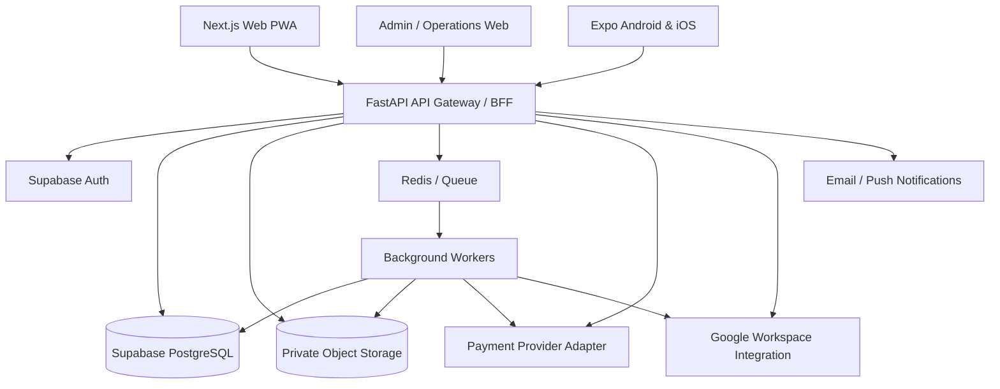
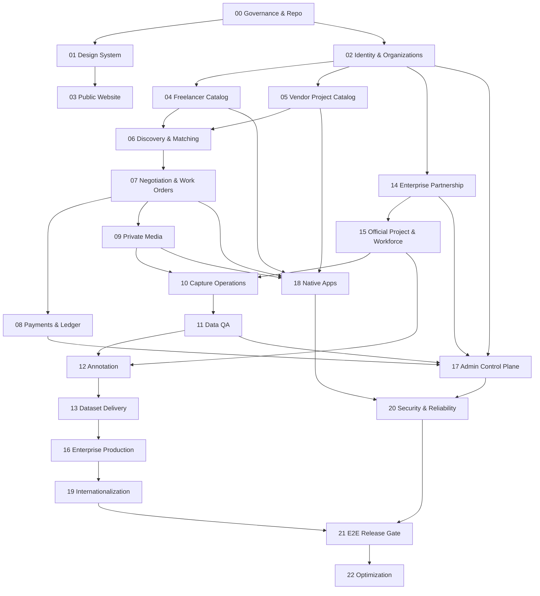

# EgvoX.ai --- Master Product Requirements Document (Master PRD)

**Dokumen:** Master PRD & Engineering Blueprint\
**Produk:** EgvoX\
**Domain utama:** egvox.ai\
**Versi:** 1.2\
**Tanggal:** 26 November 2026\
**Status:** Product, Brand & Architecture Baseline --- Ready for detailed
implementation planning\
**Bahasa dokumen:** Bahasa Indonesia\
**Target pasar awal:** Indonesia sebagai basis supply dan operasi; buyer
internasional sebagai target ekspansi\
**Model produk:** B2B/B2B2C marketplace + managed data operations\
**Scope:** Web PWA, native Android/iOS, backend API, data operations,
enterprise workflows, security, payments, deployment, dan production
readiness.

------------------------------------------------------------------------

# 0. Dokumen Kontrol dan Prinsip Utama

## 0.1 Tujuan dokumen

**Brand asset resmi:** `EgvoX_Official_Logo.webp` (file terlampir dalam paket PRD v1.2). Wordmark pada artwork menggunakan nama `EgvoX`; domain produk tetap `egvox.ai`.


Master PRD ini menjadi sumber acuan utama untuk desain produk,
arsitektur sistem, pengembangan frontend/backend, database, API,
integrasi eksternal, keamanan, QA, deployment, dan release management
EgvoX.ai.

Dokumen ini bukan sekadar proposal konsep atau foundation checklist.
Target akhirnya adalah **aplikasi utuh yang dapat digunakan secara
operasional**, mulai dari registrasi, katalog, pencarian, transaksi,
pengumpulan video, annotation, QA, pembayaran, kontrak enterprise,
hingga delivery dataset.

## 0.2 Product vision

**EgvoX.ai adalah marketplace dan managed data operations platform yang
menghubungkan Egocentric Video Contributors, Data Annotators, Dataset
Vendors/Data Providers, serta AI Companies/Enterprise Buyers untuk
menghasilkan dan memperoleh human-experience video data dan dataset
terstruktur.**

EgvoX.ai menggabungkan: - Kekuatan Datarade: provider catalog, data
products, samples, discovery, data requests, provider monetization. -
Kekuatan OpenTrain: freelancer profiles, project posting, matching,
screening, proposals, milestones, managed collection. - Kapabilitas
khusus EgvoX.ai: Egocentric Capture Specification, private raw video
submission, annotation workflow, Data QA, rights management, dan
enterprise dataset packaging.

EgvoX.ai tidak meniru keseluruhan platform pembanding. Produk dibangun
dengan model bisnis dan workflow tersendiri.

## 0.3 Keputusan produk yang tidak boleh berubah tanpa persetujuan product owner

1.  **Tidak membangun fitur AI pada scope saat ini.** Tidak ada AI Video
    Intelligence, AI Annotation, AI Copilot, AI Model Router, atau AI
    Automation dalam MVP maupun phase implementasi sekarang. Fitur AI
    hanya dapat dipertimbangkan sebagai roadmap masa depan melalui
    perubahan scope.
2.  Satu GitHub monorepo, tetapi setiap aplikasi dan service/domain
    memiliki folder, dependency, konfigurasi, API contract, deployment,
    dan lifecycle mandiri.
3.  Web App berbasis Next.js dan PWA.
4.  Native Android dan iOS menggunakan React Native Expo.
5.  Backend utama menggunakan Python FastAPI.
6.  Supabase PostgreSQL menjadi primary database; Supabase Auth untuk
    identity/authentication; Supabase Storage hanya digunakan untuk
    kebutuhan file yang sesuai. Raw video berukuran besar diprioritaskan
    pada private object storage yang sesuai untuk video.
7.  Frontend tidak mengakses database bisnis secara langsung. Semua
    operasi bisnis melewati FastAPI API gateway/domain APIs. Supabase
    client pada client hanya untuk Auth/session dan fitur yang secara
    eksplisit diizinkan.
8.  Dataset Vendor/Data Provider dapat membuat dan mempublikasikan
    Project Catalog.
9.  Freelancer Video Contributor dan Data Annotator dapat membuat dan
    mempublikasikan listing jasa sendiri di Freelancer Service Catalog.
10. AI Company/Enterprise Buyer tidak dapat mempublikasikan project dan
    tidak merekrut freelancer langsung dari katalog. Mereka mengajukan
    Enterprise Data Request dan berkontrak dengan EgvoX.ai. Platform
    membuat Official Project dan mengelola manpower serta produksi.
11. Freelancer hanya mengunggah portfolio preview/sampel yang mempunyai
    izin. Full raw video tidak menjadi produk publik di katalog.
12. Full raw video diserahkan melalui private upload setelah order/work
    agreement disetujui.
13. Vendor umumnya mempunyai annotator internal. Annotation freelance
    adalah opsi tambahan, bukan kewajiban.
14. Enterprise Managed Project mencakup collection, annotation, QA,
    packaging, dan delivery sesuai kontrak.
15. Tidak boleh mengklaim escrow atau menahan dana pelanggan sendiri
    tanpa legal review dan payment-provider arrangement yang sah.
16. Tidak boleh menggunakan dataset, portfolio, wajah, suara, atau
    personal data untuk tujuan lain di luar izin yang diberikan.

## 0.4 Istilah

  ---------------------------------------------------------------------
  Istilah                            Definisi
  ---------------------------------- ----------------------------------
  Egocentric Video                   Video dari sudut pandang orang
                                     pertama, misalnya
                                     head-mounted/chest-mounted camera

  Contributor                        Freelancer yang melakukan
                                     perekaman video

  Annotator                          Freelancer yang memberi
                                     label/annotation pada data

  Reviewer                           Personel yang memeriksa hasil
                                     annotation

  Dataset Vendor/Data Provider       Perusahaan yang mempunyai atau
                                     berwenang mengelola
                                     dataset/project dan dapat merekrut
                                     manpower melalui katalog

  Enterprise Buyer                   AI company/enterprise yang membeli
                                     layanan produksi dataset resmi
                                     dari EgvoX.ai

  Project Catalog                    Katalog project/job yang
                                     dipublikasikan Vendor

  Freelancer Service Catalog         Katalog jasa Contributor dan
                                     Annotator

  Enterprise Request                 Permintaan layanan dari Enterprise
                                     yang dikelola platform

  Official Project                   Project internal EgvoX.ai yang
                                     dibuat setelah kontrak enterprise

  Raw Video                          Video asli hasil perekaman yang
                                     belum diproses/anotasi

  Portfolio Preview                  Sampel terbatas untuk menunjukkan
                                     kapabilitas freelancer, bukan
                                     inventory data komersial

  Work Order                         Kesepakatan kerja spesifik yang
                                     menjadi sumber kebenaran transaksi

  Acceptance Criteria                Persyaratan objektif untuk
                                     menerima atau menolak hasil kerja

  Data Rights Manifest               Catatan hak, izin, consent,
                                     lisensi, dan pembatasan penggunaan
                                     data
  ---------------------------------------------------------------------

------------------------------------------------------------------------

# 1. Model Bisnis dan Product Structure

## 1.1 Tiga jalur supply/demand

### A. Dataset Vendor / Data Provider

Perusahaan ini mempunyai kebutuhan project dan umumnya memiliki tim
annotation internal. Mereka membutuhkan: - Egocentric Video
Contributors. - Kapasitas pengumpulan video. - Recruitment untuk project
tertentu. - Opsi tambahan Freelance Annotators jika kapasitas internal
tidak cukup. - Private raw video submission dan pemeriksaan platform. -
Work order, milestone, pembayaran, dan delivery.

Hak akses: - Dapat membuat Project Catalog listing. - Dapat melihat
Freelancer Service Catalog. - Dapat mengundang/memilih freelancer
melalui mekanisme platform. - Dapat mengajukan
negotiation/counteroffer. - Dapat memesan collection-only atau
collection + annotation. - Tidak otomatis memperoleh akses ke data
freelancer lain atau project vendor lain.

### B. Freelancer Video Contributor dan Data Annotator

Freelancer dapat mempublikasikan jasa sendiri.

**Video Contributor Service Listing** berisi: - Judul jasa. - Kategori
aktivitas. - Aktivitas yang mampu direkam. - Capture perspective. -
Device/camera dan mounting position. - Resolusi, FPS, format, audio. -
Kapasitas durasi dan jumlah sesi. - Lokasi dan cakupan area. -
Availability. - Harga dan model pricing. - Estimasi delivery/SLA. -
Capture experience dan portfolio preview. - Persetujuan penggunaan
portfolio.

**Data Annotator Service Listing** berisi: - Spesialisasi annotation. -
Domain knowledge. - Tools yang dikuasai. - Schema/format yang
didukung. - Kapasitas dan availability. - Harga. - Estimasi pengerjaan
dan revisi. - Sample output yang dianonimkan atau mendapat izin. - Hasil
assessment/verified skill jika tersedia.

Freelancer dapat: - Mempublikasikan listing jasa. - Menerima order
langsung dari Vendor. - Mengajukan proposal pada Project Catalog. -
Melakukan negotiation. - Mengelola order, milestone, submission, revisi,
dan payout. - Melihat reputasi dan riwayat pekerjaan miliknya sendiri.

**Larangan:** listing tidak boleh berisi full raw video yang dijual
sebagai inventory tanpa proses rights verification. Portfolio preview
harus dibatasi, misalnya 30--60 detik, dapat diberi watermark, dan hanya
ditampilkan jika pemilik mempunyai hak serta consent yang diperlukan.
Sampel tidak boleh digunakan untuk AI training atau resale tanpa izin
terpisah.

### C. AI Company / Enterprise Buyer

Enterprise tidak mempublikasikan project dan tidak melakukan direct
freelancer hiring melalui marketplace.

Workflow: 1. Enterprise mengisi Enterprise Data Request. 2. EgvoX.ai
melakukan discovery dan requirement clarification. 3. Platform menyusun
proposal, scope, quote, SLA, timeline, dan acceptance criteria. 4.
Enterprise dan EgvoX.ai menandatangani kontrak. 5. Enterprise melakukan
pembayaran sesuai milestone. 6. Platform membuat Official Project. 7.
Platform merekrut/mengalokasikan Contributor dan Annotator. 8. Platform
menjalankan collection, annotation, review, QA, packaging. 9. Enterprise
menerima dataset melalui delivery workspace. 10. Acceptance dan
penyelesaian pembayaran dilakukan sesuai kontrak.

Enterprise dapat melihat progress, dashboard, laporan, sampel yang
disetujui, dan hasil delivery. Enterprise tidak mendapatkan akses
langsung ke profil privat, kontak, atau negosiasi freelancer kecuali ada
mekanisme yang disetujui platform.

## 1.2 Dua katalog publik

### Project & Data Provider Catalog

Katalog listing pekerjaan/project milik Vendor, berisi: - Project title
and summary. - Activity category/taxonomy. - Collection requirements. -
Quantity/duration target. - Geographic scope. - Capture specification. -
Device requirements. - Data privacy/consent requirements. - Deadline and
milestones. - Pricing model/budget range. - Annotation required:
no/optional/yes. - Acceptance criteria. - Application closing date. -
Vendor verification badge/status. - Project status.

### Freelancer Service Catalog

Katalog jasa yang dibuat oleh Contributor dan Annotator, berisi: -
Service listing. - Category/specialty. - Profile and verified skills. -
Price model. - Availability/capacity. - Delivery SLA. - Portfolio
preview/sample. - Service scope and exclusions. - Service terms. -
Reviews from completed and accepted orders.

### Discovery dan search

Search harus mendukung: - Keyword. - Activity taxonomy. - Service
category. - Capture device/specification. - Resolution/FPS/format. -
Location and country. - Availability/date. - Capacity. - Price range. -
Verified status. - Annotation skill/tool. - Delivery lead time. -
Project type. - Language.

Filter tidak boleh mengungkap private attributes atau data yang tidak
relevan. Search results hanya memuat listing yang statusnya
Published/Active.

## 1.3 Product monetization

Pendapatan yang dapat diaktifkan: 1. Komisi transaksi Freelancer Service
Order. 2. Komisi transaksi Vendor Project. 3. Annotation service fee. 4.
Review/QA service fee. 5. Enterprise project margin. 6. Project
management fee. 7. Custom data collection fee. 8. Dataset
packaging/delivery fee. 9. Provider subscription atau listing promotion
pada fase selanjutnya. 10. Enterprise annual/service agreement.

Tidak boleh mengenakan biaya pendaftaran dasar yang menghambat supply.
Fee harus ditampilkan sebelum pengguna menyetujui order. Tax, payment
processing fee, refund, payout, dan withholding harus dipisahkan dalam
ledger.

------------------------------------------------------------------------

# 2. User Roles, Organizations, RBAC

## 2.1 Role matrix

  ---------------------------------------------------------------------
  Role                               Fungsi utama
  ---------------------------------- ----------------------------------
  Guest                              Menjelajahi landing page dan
                                     katalog publik

  Freelancer Contributor             Membuat listing jasa video dan
                                     mengerjakan collection

  Freelancer Annotator               Membuat listing jasa annotation
                                     dan mengerjakan tasks

  Vendor Owner                       Mengelola organisasi Vendor dan
                                     billing

  Vendor Admin                       Mengelola anggota, project, order

  Vendor Project Manager             Mengelola project dan freelancer

  Enterprise Owner                   Mengelola kontrak dan request

  Enterprise Member                  Melihat project sesuai izin

  Platform Sales/Partnership         Mengelola lead, request, proposal

  Platform Project Manager           Mengelola Official Project

  Data Operations                    Mengelola submission, collection,
                                     annotation workflow

  QA Reviewer                        Memeriksa video/annotation

  Finance Operator                   Invoice, reconciliation, payout
                                     review

  Trust & Safety                     Verification, moderation, dispute
                                     support

  Compliance Officer                 Rights, consent, retention, data
                                     requests

  Super Admin                        Platform-wide configuration dan
                                     privileged operations
  ---------------------------------------------------------------------

## 2.2 Authorization principles

-   RBAC berbasis role + organization membership + resource ownership +
    project assignment.
-   Role platform tidak boleh diberikan melalui self-registration.
-   User dapat memiliki beberapa persona, tetapi setiap organisasi dan
    workspace memiliki context terpisah.
-   Semua endpoint melakukan server-side authorization.
-   RLS menjadi defense-in-depth pada tabel yang dapat diakses melalui
    Supabase.
-   Service-role key hanya berada di backend/worker secret store.
-   Tidak boleh mengandalkan hide/show UI sebagai security control.
-   Setiap perubahan role, membership, payout destination, contract,
    license, dan permission dicatat di audit log.

## 2.3 Organization onboarding

Vendor dan Enterprise harus memiliki organization profile: - Legal
name. - Trading name. - Country of registration. - Registration/tax
identifier sesuai yurisdiksi. - Website. - Business email/domain. -
Address. - Contact person. - Industry. - Business purpose. - Authorized
representative. - Verification status. - Required documents. - Terms
acceptance.

Enterprise account tidak otomatis mendapat akses publikasi Project
Catalog.

------------------------------------------------------------------------

# 3. Landing Page dan Public Website

## 3.1 Tujuan landing page

Landing page harus menjelaskan EgvoX.ai kepada empat audiens: 1. Video
Contributors. 2. Data Annotators. 3. Dataset Vendors/Data Providers. 4.
AI Companies/Enterprise Buyers.

Desain: modern B2B technology, professional, minimal, readable,
mobile-first, light background sebagai default, optional dark mode,
tidak menggunakan visual AI generik berlebihan.

## 3.2 Struktur landing page

### Header/navigation

-   Logo EgvoX.
-   Platform.
-   How It Works.
-   For Contributors.
-   For Data Providers.
-   Enterprise Solutions.
-   Project Catalog.
-   Freelancer Catalog.
-   Resources/FAQ.
-   Language selector.
-   Sign In.
-   Join EgvoX / Get a Quote CTA.

### Hero section

Headline rekomendasi: **"The Human Experience Data Network for AI &
Robotics."**

Supporting copy: "Connect with verified video contributors, data
annotators, and managed data operations to collect, process, validate,
and deliver human-experience datasets."

CTA: - Explore Marketplace. - Become a Contributor. - Become a Data
Provider. - Partner with EgvoX.

Hero harus menampilkan alur ekosistem: contributor → capture →
annotation → QA → dataset delivery. Hindari klaim bahwa EgvoX sudah
memiliki teknologi AI proprietary.

### Section: What is EgvoX?

Menjelaskan: - Egocentric video collection. - Human activity data. -
Data annotation services. - Vendor marketplace. - Enterprise managed
data production.

### Section: Benefits & Advantages

Untuk Contributor: - Akses project. - Listing jasa sendiri. - Negosiasi
transparan. - Work order dan milestone. - Submission dan acceptance
tracking. - Reputasi berdasarkan pekerjaan selesai.

Untuk Vendor: - Akses supply contributor. - Publish collection
projects. - Temukan talent berdasarkan spesifikasi. - Optional
annotation manpower. - Private submission dan QA process. - Project
progress dan transaction records.

Untuk Enterprise: - Satu kontrak dengan platform. - Managed collection
dan annotation. - Workforce allocation. - Quality assurance. - Dataset
packaging dan delivery. - Project reporting dan SLA.

### Section: How EgvoX Works

Tampilkan tiga alur: 1. Vendor Project Marketplace. 2. Freelancer
Service Order. 3. Enterprise Managed Data Project.

### Section: EgvoX System

Visual enam sistem: - Freelancer Network. - Project Catalog. - Service
Catalog. - Data Operations. - Enterprise Management. - Super Admin
Control Plane.

### Section: Business Model

Jelaskan secara transparan: - Marketplace commission. - Managed project
service. - Collection services. - Annotation and QA services. - Dataset
packaging. - Enterprise contracts.

### Section: Project Catalog preview

Menampilkan listing Project Catalog aktif dan publik. - Project title. -
Activity category. - Budget/rate information bila disetujui. -
Location. - Deadline. - Vendor verification indicator. - CTA "View
Project Catalog" atau "More Projects".

Klik "More" menuju halaman Marketplace dengan filter `type=projects`.

### Section: Freelancer Catalog preview

Menampilkan jasa Video Contributor dan Data Annotator. - Profile/service
title. - Category. - Capability. - Price model/range. -
Location/availability bila publik. - Portfolio preview yang telah
disetujui. - Verified status. - CTA "Explore Freelancer Services" atau
"More Services".

Klik "More" menuju Marketplace dengan filter `type=services`.

### Section: Become a Freelancer

CTA registrasi Freelancer: - Pilih Video Contributor atau Data Annotator
atau keduanya. - Buat akun. - Verifikasi identitas sesuai risk tier. -
Lengkapi profile. - Lengkapi capability. - Upload portfolio sample. -
Submit untuk moderation. - Publish listing setelah disetujui.

### Section: Become a Dataset Vendor

CTA registrasi Vendor: - Buat organization. - Submit business profile. -
Verifikasi dokumen dan kewenangan. - Setujui Vendor Terms. - Buat
Project Catalog listing. - Publish setelah moderation.

### Section: Enterprise Partnership

Form permintaan kerja sama: - Company name. - Country. - Website. -
Business email. - Contact person/title. - Data requirement category. -
Activity/domain. - Estimated volume/hours. - Countries/locations. -
Capture specifications. - Annotation requirements. - Delivery format. -
Deadline. - Budget range (optional). - Compliance/security
requirements. - Additional notes. - Consent to contact.

Form hanya membuat lead/request status `submitted`; bukan kontrak dan
bukan order otomatis.

### Section: Trust, Rights & Quality

Jelaskan: - Private raw video handling. - Consent and rights
governance. - Acceptance criteria. - Quality review. - Access control. -
Secure delivery.

### Section: FAQ, Resources, Footer

FAQ untuk role, listing, pricing, upload, payment, licensing, data
privacy, dispute, enterprise contract, and supported countries. Footer
berisi legal links, privacy, terms, contact, language, status page, and
social channels yang resmi.

## 3.4 Domain dan subdomain resmi EgvoX.ai

EgvoX.ai menggunakan domain utama sebagai brand root dan memisahkan
pengalaman produk berdasarkan subdomain. Nama subdomain berikut adalah
rekomendasi arsitektur dan harus diverifikasi ketersediaan DNS/domain
sebelum aktivasi.

  ---------------------------------------------------------------------------------
  Hostname                 Produk/service    Pengguna          Fungsi utama
  ------------------------ ----------------- ----------------- --------------------
  `egvox.ai`               Corporate &       Publik, calon     Landing page,
                           Marketing Website freelancer,       product explanation,
                                             Vendor,           benefits, how it
                                             Enterprise        works, business
                                                               model, FAQ, SEO, CTA

  `marketplace.egvox.ai`   Marketplace Web   Guest,            Katalog project,
                           App               Freelancer,       katalog jasa
                                             Vendor,           freelancer,
                                             Enterprise        pencarian, detail
                                                               listing, registrasi
                                                               dan login seluruh
                                                               role non-super-admin

  `app.egvox.ai`           Main Workspace /  Freelancer,       Dashboard setelah
                           Customer Portal   Vendor,           login, orders,
                                             Enterprise        applications,
                                                               projects, messages,
                                                               earnings, delivery,
                                                               account settings

  `admin.egvox.ai`         Super Admin       Super             Platform-wide
                           Control Plane     Admin/platform    administration,
                                             privileged staff  moderation,
                                                               verification,
                                                               finance, compliance,
                                                               audit, configuration

  `ops.egvox.ai`           Data Operations   Data Operations,  Submission queues,
                           Workspace         QA Reviewer,      private media
                                             Project Manager,  review, annotation
                                             Annotation        assignment/review,
                                             Operations        QA, acceptance,
                                                               packaging

  `api.egvox.ai`           API Gateway /     Web, native apps, Versioned REST API,
                           Backend API       trusted           authentication
                                             integrations      validation, routing,
                                                               rate limiting, API
                                                               documentation
                                                               internal

  `status.egvox.ai`        Service Status    Semua pengguna    Operational status,
                                                               incident history,
                                                               maintenance notices

  `docs.egvox.ai`          Help Center /     Semua pengguna    User guides,
                           Documentation                       contributor SOP,
                                                               Vendor guide,
                                                               Enterprise
                                                               onboarding, support
                                                               articles
  ---------------------------------------------------------------------------------

**Pemisahan akses penting:** - `marketplace.egvox.ai` adalah domain
khusus marketplace. Domain ini menampilkan Project Catalog dan
Freelancer Service Catalog secara lengkap. - Marketplace menyediakan
registrasi dan login untuk Guest yang ingin menjadi Freelancer, Dataset
Vendor/Data Provider, atau Enterprise Buyer. - **Super Admin tidak boleh
mendaftar atau login melalui marketplace.** Super Admin hanya melalui
`admin.egvox.ai` dengan identity provider/role provisioning khusus. -
`app.egvox.ai` adalah workspace setelah login. User dapat diarahkan ke
dashboard berdasarkan role dan active organization. - `ops.egvox.ai`
adalah workspace operasional internal. Akses dibatasi untuk personel
platform yang memiliki permission. - `api.egvox.ai` bukan halaman publik
untuk pengguna akhir. API hanya menerima request dari client dan
integration yang terotorisasi. - Subdomain tidak otomatis menjadi
security boundary. Semua akses tetap divalidasi oleh backend melalui
token, role, organization membership, resource permission, dan policy.

### 3.4.1 Landing page corporate --- `egvox.ai`

Landing page tetap menjadi situs marketing dan acquisition: - Apa itu
EgvoX. - Manfaat dan keunggulan. - Cara kerja EgvoX. - Sistem EgvoX. -
Model bisnis. - Preview Project Catalog. - Preview Freelancer Service
Catalog. - Registrasi Freelancer. - Registrasi Dataset Vendor. -
Enterprise Partnership Request. - FAQ, legal, contact, dan language
selector.

CTA katalog mengarah ke: - `marketplace.egvox.ai/projects` untuk Project
Catalog. - `marketplace.egvox.ai/services` untuk Freelancer Service
Catalog.

CTA registrasi mengarah ke halaman registrasi marketplace dengan role
intent: - `marketplace.egvox.ai/register?type=freelancer` -
`marketplace.egvox.ai/register?type=vendor` -
`marketplace.egvox.ai/register?type=enterprise`

Parameter `type` hanya mengatur onboarding path awal, bukan memberikan
role/permission secara otomatis. Role aktif diberikan setelah
server-side onboarding dan verification policy.

### 3.4.2 Marketplace khusus --- `marketplace.egvox.ai`

Marketplace adalah aplikasi web tersendiri, bukan sekadar section di
landing page.

Public routes: - `/` - `/projects` - `/projects/[slug]` - `/services` -
`/services/video-contributors` - `/services/data-annotators` -
`/services/[slug]` - `/providers/[slug]` - `/freelancers/[username]` -
`/categories/[slug]` - `/register` - `/login` - `/forgot-password` -
`/verify-email` - `/onboarding/freelancer` - `/onboarding/vendor` -
`/onboarding/enterprise` - `/enterprise/partnership`

Authenticated marketplace routes dapat menampilkan: - Saved listings. -
Applications. - Service order initiation. - Proposal initiation. -
Conversation entry points. - Account switcher/organization selector.

Marketplace tidak harus menampilkan semua fungsi dashboard operasional.
Setelah login atau ketika user memilih "Open Workspace", arahkan ke
`app.egvox.ai`.

### 3.4.3 Main workspace --- `app.egvox.ai`

Workspace menyediakan pengalaman terautentikasi: - Role-based
dashboard. - Freelancer profile/service management. - Vendor project
management. - Enterprise request, proposal, contract, and project
view. - Applications, offers, negotiation. - Work Orders and
milestones. - Messages and notifications. - Submission status. -
Earnings/invoices/payouts. - Account, security, team, and organization
settings.

Routing setelah login: - Freelancer Contributor/Annotator →
`/freelancer/dashboard`. - Vendor Owner/Admin/Project Manager →
`/vendor/dashboard`. - Enterprise Owner/Member →
`/enterprise/dashboard`. - Jika user mempunyai beberapa
role/organization, tampilkan role/organization selector; jangan memilih
organisasi secara diam-diam.

### 3.4.4 Super Admin --- `admin.egvox.ai`

Super Admin mempunyai subdomain terpisah dan tidak muncul pada pilihan
registrasi publik. - Login hanya untuk account yang sudah di-provision
oleh authorized platform administrator. - MFA wajib. - Privileged
session dan re-authentication untuk aksi berisiko. - RBAC granular. -
Audit log untuk seluruh privileged action. - Tidak ada public
self-signup. - Break-glass access wajib memiliki alasan, expiry, dan
audit.

### 3.4.5 Data Operations --- `ops.egvox.ai`

Workspace khusus internal operations: - Upload/quarantine queues. -
Media validation. - Capture specification review. - Consent/rights
review. - Annotation task management. - Reviewer queues. - Rework and
acceptance. - Dataset packaging. - Delivery handoff. - Project SLA and
operational monitoring.

Akses ke raw video harus berdasarkan assignment dan least privilege. Ops
subdomain tidak berarti seluruh staff otomatis dapat melihat seluruh
video.

### 3.4.6 API --- `api.egvox.ai`

-   Semua API memakai prefix `/api/v1`.
-   OpenAPI/Swagger tidak boleh menampilkan secret atau data privat.
-   Public API endpoints hanya untuk katalog, kategori, CMS, dan public
    request intake.
-   Authenticated endpoints memerlukan token valid.
-   Webhooks memiliki endpoint khusus dan signature verification.
-   Rate limit berbeda per route/role.
-   Internal service-to-service calls memakai service identity, bukan
    user token yang dipalsukan.
-   CORS allowlist untuk domain EgvoX yang benar-benar digunakan.
-   Native apps memakai API yang sama, bukan endpoint database langsung.

### 3.4.7 DNS, TLS, cookies, dan deployment

-   Setiap subdomain memiliki DNS record dan TLS certificate.
-   Cookie scope dibuat sesempit mungkin. Jangan memakai cookie
    `Domain=.egvox.ai` secara default jika session sharing lintas
    subdomain tidak diperlukan.
-   Preferensi: session/token dikelola melalui secure, HttpOnly cookies
    pada web/BFF atau mekanisme SDK yang sesuai; native app menggunakan
    secure token storage.
-   CORS hanya mengizinkan origin yang diperlukan.
-   CSP dan security headers dikonfigurasi per aplikasi.
-   Setiap subdomain dapat mempunyai deployment dan rollback mandiri.
-   Shared authentication harus dirancang secara eksplisit; subdomain
    tidak boleh menganggap session otomatis terbagi.
-   Preview/staging memakai domain non-production terpisah, misalnya
    `preview-marketplace.egvox.ai` atau environment domain
    Railway/Vercel yang dibatasi aksesnya. Jangan gunakan data
    production tanpa persetujuan dan sanitasi.

## 3.5 Native App: Marketplace-first, tanpa marketing landing page

Aplikasi React Native Expo Android/iOS tidak perlu mereplikasi landing
page corporate `egvox.ai`.

Ketika aplikasi dibuka: - Guest melihat marketplace discovery: Project
Catalog, Freelancer Service Catalog, kategori, search, dan featured
listings. - Pengguna dapat login atau registrasi dari aplikasi. -
Registrasi menyediakan role intent Freelancer, Dataset Vendor, atau
Enterprise Buyer. - Super Admin tidak tersedia dalam native app
publik. - Setelah autentikasi, aplikasi menampilkan dashboard sesuai
role. - Deep link ke project/service detail harus dapat dibuka langsung
di native app. - Link marketing/legal/help dapat membuka halaman web
yang relevan, tetapi bukan menjadi landing screen utama aplikasi.

Native app information architecture: - Explore. - Projects. -
Services. - Saved. - Inbox. - My Work / Dashboard. - Profile.

Tab dan menu harus menyesuaikan role: - Contributor: Explore Projects,
My Services, Applications, Orders, Uploads, Earnings. - Annotator:
Annotation Jobs, My Services, Tasks, Reviews, Earnings. - Vendor:
Projects, Find Freelancers, Orders, Deliveries, Billing. - Enterprise:
Requests, Contracts, Official Projects, Progress, Deliveries. - Guest:
Explore, Projects, Services, Sign In/Join.

Native app harus menggunakan API `api.egvox.ai`; tidak boleh mengakses
Supabase database secara langsung untuk operasi bisnis. Upload video
menggunakan secure upload session dan resumable/multipart upload ke
private storage.

## 3.3 CMS/configuration

Landing page copy, hero, FAQ, category cards, featured listings, footer,
legal content, and SEO metadata harus dapat dikelola melalui admin CMS
atau configuration tables. Jangan hardcode seluruh konten ke frontend.

------------------------------------------------------------------------

# 4. Marketplace Experience

## 4.1 Marketplace route structure

-   `/marketplace`
-   `/marketplace/projects`
-   `/marketplace/projects/[slug]`
-   `/marketplace/services`
-   `/marketplace/services/[slug]`
-   `/marketplace/services/video-contributors`
-   `/marketplace/services/data-annotators`
-   `/providers/[slug]`
-   `/freelancers/[username]`

## 4.2 Listing lifecycle

`draft → submitted → under_review → changes_requested → approved → published → paused/expired → archived/rejected`

Only approved/published listing appears publicly. Owner can edit drafts.
Material changes to price, rights, scope, sample, or technical
specifications may require re-moderation.

## 4.3 Project Catalog detail page

Must show: - Vendor organization and verification. - Project
title/summary. - Activity category and taxonomy. - Scope and
deliverables. - Capture specification. - Location/country. - Volume and
capacity. - Budget/rate model. - Deadline and milestones. - Acceptance
criteria. - Annotation requirement. - Data rights and permitted use
summary. - Application requirements. - FAQ and project updates. -
Apply/Submit Proposal CTA. - Report listing.

## 4.4 Freelancer Service detail page

Must show: - Freelancer profile and verification state. - Service
title/description. - Specialty/capability. - Technical specification. -
Availability/capacity. - Pricing model. - Delivery SLA. - Portfolio
preview/sample with consent. - Terms, revisions, exclusions. - Reviews
from verified completed orders. - Request Order CTA. - Contact through
platform messaging only.

## 4.5 Search and ranking algorithm

Initial deterministic ranking, not AI: - Exact category match. -
Skill/capability match. - Required equipment/specification match. -
Availability overlap. - Capacity sufficiency. - Location/country
constraints. - Price fit. - Delivery timeline fit. - Verified status. -
Completed-job performance. - Acceptance and cancellation history.

Ranking weights are configurable and versioned. Do not use sensitive
personal attributes. New freelancers must have fair discovery
opportunities. Paid promotion must be labeled and must not override
mandatory eligibility constraints.

------------------------------------------------------------------------

# 5. Egocentric Capture Specification

This is a core EgvoX differentiator.

## 5.1 Capture taxonomy

Activity categories must be hierarchical and extensible: - Automotive &
Mechanical. - Warehouse & Logistics. - Manufacturing & Assembly. -
Household Activities. - Food Preparation & Kitchen. - Retail & Store
Operations. - Agriculture. - Construction & Maintenance. -
Office/Professional Tasks. - Other approved domains.

Categories must support subcategories and task taxonomies. Healthcare or
sensitive environments require additional policy and legal review before
activation.

## 5.2 Technical capture fields

Each project specification can define: - Perspective:
egocentric/first-person. - Camera mounting:
head/chest/glasses/handheld/other. - Device make/model (optional or
required). - Resolution. - Frame rate. - Codec/container. -
Orientation. - Minimum/maximum clip duration. - Audio
required/optional/forbidden. - Stabilization requirements. - Field of
view requirements. - Lighting/environment. - Activity sequence. - Object
visibility requirements. - Required metadata. - GPS/location policy. -
Timestamp/timezone. - Participant consent. - Bystander/third-party
handling. - Privacy redaction requirements. - File naming and upload
instructions. - Delivery deadline. - Re-record/revision policy.

Not every field is mandatory for every project. Project owner selects a
capture template and marks each requirement as required, optional, or
not applicable.

## 5.3 Capture templates and versioning

-   Capture specification has version number.
-   Work order references an immutable specification version.
-   Changes after order agreement require change request and acceptance
    by affected parties.
-   Contributor must acknowledge the exact specification version.
-   QA must validate against the version referenced by the Work Order.

------------------------------------------------------------------------

# 6. Transaction, Negotiation and Contract Engine

## 6.1 Supported transaction types

1.  `freelancer_service_order`: Vendor orders a Freelancer Service
    Catalog listing.
2.  `vendor_project_application`: Freelancer applies to Vendor Project
    Catalog.
3.  `vendor_direct_invitation`: Vendor invites freelancer to project.
4.  `vendor_annotation_order`: Vendor orders optional annotation
    service.
5.  `vendor_managed_work_order`: Vendor project involving multiple
    freelancers.
6.  `enterprise_managed_contract`: Enterprise contracts EgvoX.ai for
    managed data production.

## 6.2 Negotiation

Offer types: - Fixed price. - Hourly. - Per accepted video hour. - Per
recording session. - Per task/frame/clip. - Per annotation unit. - Per
project. - Milestone-based. - Custom quote.

Negotiation lifecycle:
`draft → sent → viewed → countered → accepted/rejected/expired → agreement_generated`

Offer must include: - Scope. - Quantity/volume. - Rate and currency. -
Fees/taxes. - Deadline. - Milestones. - Acceptance criteria. -
Revisions. - Rights and license. - Consent responsibilities. -
Cancellation. - Dispute procedure. - Payment schedule.

All accepted terms become a versioned Work Order. No silent edits to
accepted terms.

## 6.3 Contract documents

Generate PDF contract/work order from approved templates. Store: -
Contract version. - Parties and signatory. - Scope and schedules. -
Pricing and payment milestones. - Rights/license schedule. - Data
protection schedule. - Acceptance criteria. - Signature status and
timestamps. - Document checksum. - Audit trail.

Electronic signature provider integration may be added based on legal
jurisdiction. A checkbox is not a substitute for legally required
signatures.

------------------------------------------------------------------------

# 7. Private Raw Video Submission & Media Management

## 7.1 Core rule

Full raw video must never be exposed as public marketplace inventory.
Video is submitted only against a valid project/order/work assignment
and is accessible only to authorized parties.

## 7.2 MVP storage approach

Google Workspace Shared Drive controlled by EgvoX.ai can be used as a
transitional/manual MVP workflow if operational controls are
implemented. It should not be treated as the permanent large-scale video
data plane.

Preferred production direction: - Private S3-compatible object
storage. - Multipart/resumable upload. - Short-lived signed
upload/download URLs. - Server-side file registration. - Checksum
verification. - Malware scanning/quarantine. - Lifecycle and retention
policies. - Encryption in transit and at rest. - Access audit.

Google Drive links supplied by a freelancer may be accepted only as a
temporary intake source if policy allows. Platform must copy the file
into controlled storage, verify the copy, record checksums, and prevent
source-link dependence. A personal Drive link must not be the final
proof of delivery.

## 7.3 Upload workflow

1.  Work Order becomes funded/authorized according to payment terms.
2.  Platform creates submission slot and upload session.
3.  Contributor receives a short-lived, scoped upload permission.
4.  File uploads to quarantine/private raw zone.
5.  Backend records object key, file ID, uploader, project/order,
    timestamp, size, MIME, duration, checksum, and version.
6.  Automated technical validation checks format, size, integrity,
    duration, codec, and malware.
7.  Data Operations performs manual content/specification/privacy
    review.
8.  File status becomes accepted, rework_required, rejected, or
    quarantined.
9.  Accepted file is promoted to accepted zone/version; original is
    immutable.
10. Vendor receives access only according to contract/license.
11. Payment eligibility is calculated for accepted units.

## 7.4 File status lifecycle

`created → upload_pending → uploading → uploaded → quarantined → technical_validation → human_review → accepted/rework_required/rejected → delivered → retained/expired/deleted`

File status is separate from transaction status. One transaction may
contain multiple files with different acceptance results.

## 7.5 File integrity and versioning

-   SHA-256 checksum required.
-   File version immutable after acceptance.
-   Replacement creates new version and re-enters QA.
-   Record uploader and source.
-   Record server-side timestamps.
-   Record storage location/object key.
-   Record access/download events.
-   Signed URL expiry configurable.
-   Do not log signed URL secrets or full sensitive media URLs.
-   Do not expose bucket/object keys publicly.

## 7.6 Access model

-   Contributor: upload own assigned files and view own submission
    status.
-   Vendor: view/download accepted files licensed to that Vendor.
-   Annotator: access only assigned accepted media, time-limited.
-   Reviewer: access only assigned review media.
-   Enterprise: access only contract-approved samples/deliverables.
-   Platform Data Operations: access based on role and project
    assignment.
-   Super Admin: no routine unrestricted media browsing; break-glass
    access requires justification and audit.

------------------------------------------------------------------------

# 8. Annotation Workflow

## 8.1 Annotation service types

-   Action Recognition.
-   Temporal Action Segmentation.
-   Object Detection/Bounding Boxes.
-   Object Tracking.
-   Hand-Object Interaction.
-   Human/Hand Pose annotation.
-   Activity Classification.
-   Scene Understanding.
-   Video Captioning.
-   Event/Temporal Labeling.
-   QA and annotation review.

Only activate annotation types for which schema, tools, and reviewer
competence are available.

## 8.2 Vendor annotation options

-   Raw Video Only: Vendor handles internal annotation.
-   Raw Video + Freelance Annotation: optional freelancer annotation
    service.
-   Collection + Annotation + Review: platform coordinates contributors,
    annotators, reviewers.
-   Enterprise Managed Annotation: platform owns delivery responsibility
    under enterprise contract.

## 8.3 Annotation task lifecycle

`draft → ready → assigned → in_progress → submitted → reviewer_assigned → review → revision_requested/accepted/rejected → finalized`

Task data: - Project and source media. - Annotation schema/version. -
Task unit/time range. - Instructions/SOP. - Assigned annotator. - Due
date. - Output files. - Revision count. - Reviewer. - Acceptance
decision. - Audit history.

## 8.4 Annotation workspace requirements

-   Video player with timeline.
-   Frame/time navigation.
-   Label taxonomy panel.
-   Segment creation/editing.
-   Object/track identifiers.
-   Annotation metadata editor.
-   Save draft/autosave.
-   Submission and revision workflow.
-   Keyboard shortcuts.
-   Version history.
-   Schema validation.
-   Export preview.
-   Accessibility and responsive desktop-first annotation workspace.

Do not assume full annotation productivity on mobile. Mobile can support
task notifications, simple review, and status; complex labeling should
be optimized for desktop/tablet.

## 8.5 Annotation schema and exports

Support configurable schema with versioning. Initial export formats
should be selected by demand, for example JSON/JSONL, CSV, and common
computer vision formats where applicable. RLDS, LeRobot, and robotics
formats are later capability extensions and must not be promised unless
required signals and schema exist.

------------------------------------------------------------------------

# 9. Data QA, Acceptance & Disputes

## 9.1 QA layers

1.  File-level technical validation.
2.  Capture specification validation.
3.  Content/activity validation.
4.  Privacy and consent review.
5.  Metadata completeness.
6.  Annotation schema validation.
7.  Annotation quality review.
8.  Dataset package validation.
9.  Final buyer acceptance.

## 9.2 Acceptance criteria

Every Work Order must define: - Required activities. - Technical
minimums. - Duration/quantity. - Metadata. - Privacy rules. - Annotation
schema. - Tolerances. - Revision count. - Review SLA. - Rejection
reasons. - Appeal/dispute process.

No unlimited rejection. No discretionary rejection without a reason code
and evidence.

## 9.3 Partial acceptance

A batch may contain accepted, rework, rejected, or quarantined files.
Payment eligibility is based on accepted units according to contract.
Accepted units should not be held indefinitely because other files in
the same batch are disputed unless contract explicitly says otherwise.

## 9.4 Dispute lifecycle

`opened → evidence_requested → under_review → decision_proposed → accepted_by_parties/appealed → resolved`

Dispute record contains: - Transaction and file/task references. - Claim
category. - Evidence. - Communication. - Review assignment. - Decision
and rationale. - Financial adjustment. - Appeal status. - Audit events.

------------------------------------------------------------------------

# 10. Rights Management, Consent & Compliance

## 10.1 Rights registry

Separate and explicitly record: - Copyright/ownership of raw
recording. - Contributor grant to platform for operational processing. -
Vendor license. - Enterprise license. - Commercial use. - AI training
permission (out of current product scope, but rights field must
distinguish it). - Resale/redistribution rights. - Exclusivity. -
Territory. - Duration. - Third-party access. - Derivative works. -
Annotation rights. - Retention and deletion. - Consent records and
revocation handling.

Having a file in storage does not prove ownership or legal right to use
it.

## 10.2 Consent and privacy

Capture workflow must address: - Contributor consent. -
Bystander/third-party consent where required. - Faces and voices. -
Private homes/workplaces. - Location data. - Personal identifiers. -
Employer/site permission. - Sensitive environments. - Data
minimization. - Retention period. - Cross-border transfer. - Data
subject requests.

The platform must implement privacy-by-design and jurisdiction-specific
legal review, including Indonesia's Personal Data Protection Law and
applicable laws in buyer/data collection countries. This PRD is not
legal advice.

## 10.3 Rights gate

A file cannot be accepted for commercial delivery if required
rights/consent evidence is missing or inconsistent. The platform may
quarantine it pending review.

## 10.4 Portfolio rights

Portfolio previews: - Must be owned or licensed by the freelancer. -
Must not expose confidential client data. - Must have required
consent. - Must have a limited preview duration/size. - May be
watermarked. - Must be removable/expirable under policy. - Cannot be
automatically resold or used for training.

------------------------------------------------------------------------

# 11. Enterprise Partnership & Managed Operations

## 11.1 Enterprise request form

Fields: - Company/legal name. - Country. - Website/domain. - Business
email. - Contact person and role. - Business use case. - Activity/domain
categories. - Estimated video hours/quantity. - Target
countries/locations. - Device and capture specifications. - Annotation
types and schema. - Metadata requirements. - Delivery format. - Security
requirements. - Deadline. - Budget range. - Procurement/PO
requirements. - Legal/compliance needs. - Additional documents.

## 11.2 Enterprise lifecycle

`lead_submitted → qualification → discovery → requirements_defined → proposal_draft → proposal_sent → negotiation → contract_pending → contract_signed → funded/PO_approved → official_project_created → production → QA → delivery_review → accepted → closed`

## 11.3 Official Project creation

On contract activation: - Create internal project. - Freeze
scope/specification version. - Create budget and cost plan. - Create
work packages. - Determine contributor/annotator/reviewer capacity. -
Publish internal/restricted recruitment tasks. - Assign project manager
and data operations. - Create milestones and acceptance gates. - Enable
enterprise progress dashboard.

Enterprise project is not automatically published to public Project
Catalog.

## 11.4 Workforce allocation

Platform PM can: - Search eligible freelancers. - Invite selected
contributors. - Create restricted project call. - Allocate capacity. -
Track confirmed capacity. - Monitor delivery. - Replace/augment
workforce subject to contract and contributor agreement.

## 11.5 Enterprise dashboard

-   Contract overview.
-   Project milestones.
-   Collection progress.
-   Accepted/rejected/rework volume.
-   Annotation progress.
-   QA status.
-   Risk and issue log.
-   Delivery packages.
-   Reports and documents.
-   Invoice/payment status.
-   Change requests.
-   Communication log.

------------------------------------------------------------------------

# 12. Payment, Stripe & Financial Ledger

## 12.1 Payment architecture

Implement a provider-agnostic Payment Service. Stripe is an integration
target, not a hardcoded assumption that every payment method/country is
immediately available.

**Important operational constraint:** Stripe's official information
currently lists Indonesia as a Preview/invite-only market. Stripe's
Indonesia support page states that Indonesian Stripe accounts currently
support Indonesia bank transfer/virtual account, accept IDR only, and do
not support cross-border transactions from Indonesian accounts.
Therefore, international payment acceptance cannot be promised using an
Indonesia-based Stripe account alone. EgvoX must confirm merchant
eligibility and Stripe product availability directly before production.
See sources in Section 22.

For international scale: - Evaluate an eligible Stripe account structure
only where legally and operationally valid. - Evaluate Stripe Connect
only after country, connected-account, payout, and marketplace
eligibility checks. - Keep an alternative licensed PSP/provider adapter
for Indonesia and other countries. - Do not create an offshore entity or
misrepresent merchant location solely to bypass availability
restrictions.

## 12.2 Payment capabilities

-   Payment intent/checkout.
-   Invoice.
-   Payment status webhook.
-   Refund.
-   Partial refund.
-   Milestone payment.
-   Platform fee/commission calculation.
-   Payout eligibility.
-   Payout request.
-   Payout status.
-   Reconciliation.
-   Dispute/chargeback records.
-   Currency and FX records.
-   Tax/fee breakdown.

## 12.3 Marketplace money flow

The system must distinguish: - Buyer payment. - Freelancer gross
earning. - Platform commission. - Provider fee. - Payment processing
fee. - Tax. - Refund. - Adjustment. - Payout.

Use an append-only financial ledger with idempotent postings. Never rely
only on mutable `orders.total_amount` as the financial source of truth.

Do not call platform-held funds "escrow" unless legal/payment-provider
structure permits it. Use funded order, payment authorization/capture,
provider-managed split/payout, or milestone billing according to
approved payment flow.

## 12.4 Payment state machine

`created → pending → requires_action → authorized/paid → partially_refunded/refunded/failed/canceled`

Payout:
`not_eligible → eligible → queued → processing → paid/failed/reversed`

Webhook requirements: - Verify signature. - Idempotency key. - Store
event ID. - Reject replay/duplicate processing. - Reconcile provider
status. - Never trust frontend payment success redirect as final proof.

## 12.5 Commission configuration

-   Commission by transaction type.
-   Optional category-specific fee.
-   Vendor/enterprise negotiated rates.
-   Minimum/maximum fee where contractually defined.
-   Versioned fee policy.
-   Show net payout estimate before acceptance.
-   Record fee snapshot on Work Order.

------------------------------------------------------------------------

# 13. Internationalization, Localization & Multi-Currency

## 13.1 Languages

Initial language: - English. - Bahasa Indonesia.

Architecture must support additional languages without code changes to
core logic.

## 13.2 Localization

-   Locale-aware date/time.
-   Timezone per user and project.
-   Number/currency formatting.
-   Country-specific address format.
-   Localized emails/notifications.
-   Localized legal terms.
-   Translation status and fallback.
-   RTL readiness if future languages require it.

## 13.3 Currency

-   Store amount in integer minor units where applicable.
-   Store currency code ISO 4217.
-   Store original currency and conversion metadata separately.
-   Do not silently convert agreed Work Order currency.
-   FX rate source and timestamp must be stored if conversion is used.
-   Payment provider country/currency limitations must be enforced
    server-side.

------------------------------------------------------------------------

# 14. Web PWA, Native Android/iOS & UI/UX

## 14.1 Web PWA

Technology: - Next.js. - React. - TypeScript. - Responsive design. - PWA
manifest. - Service worker. - Installable app experience. - Offline
shell and limited offline drafts where safe. - Push notifications with
consent. - Deep links. - Accessibility.

PWA must not cache private raw video, sensitive documents, auth tokens,
or private API responses in unsafe shared caches.

## 14.2 Native mobile

Technology: - React Native. - Expo. - Expo Router. - TypeScript. - EAS
Build/Submit. - SecureStore for sensitive local tokens/credentials. -
Camera/media access with explicit permissions. - Upload queue and
resumable upload. - Background upload behavior subject to OS
limitations. - Push notifications. - Deep links/universal links.

Native apps: - Freelancer app experience. - Vendor/Enterprise companion
experience. - Data Operations reviewer companion where appropriate.

Do not assume one universal mobile screen can replace the desktop
annotation workstation. Complex annotation, project administration,
contract review, and finance should remain desktop-optimized.

## 14.3 Official Brand Identity & Logo System

### 14.3.1 Official logo

Logo resmi platform adalah **EgvoX** (tanpa suffix “AI” pada artwork/wordmark), menggunakan file master `EgvoX_Official_Logo.webp` yang disertakan bersama dokumen ini. Domain `egvox.ai` tetap menjadi alamat domain produk; domain tidak wajib ditampilkan di logo.

Konsep visual logo:
- Wordmark `Egvo` menggunakan bentuk rounded geometric sans-serif dengan warna teal/turquoise.
- Ikon `X` menggunakan konsep **Workflow X**: dua pita/arah yang berpotongan, elemen play sebagai petunjuk video, serta swoosh/panah sebagai simbol proses dan delivery.
- Aksen kotak/pixel di sisi kiri wordmark menjadi elemen pendukung identitas digital.
- Makna brand: video capture → data processing → annotation → quality assurance → dataset delivery.

### 14.3.2 Logo usage rules

- Gunakan artwork resmi tanpa menggambar ulang, mengubah proporsi, mengganti warna, atau memisahkan elemen secara tidak konsisten.
- Clear space minimum: tinggi kotak aksen kecil di kiri wordmark pada seluruh sisi logo.
- Minimum width rekomendasi: 160 px untuk header web; 96 px hanya jika keterbacaan masih terjaga. Untuk ukuran lebih kecil gunakan simbol X saja.
- Sediakan varian horizontal penuh, symbol-only X, monochrome dark, monochrome white, dan versi high-contrast untuk kebutuhan produksi. Varian turunan harus dibuat dari master artwork dengan geometri yang sama.
- Background pilihan: putih atau neutral sangat terang. Pada dark mode gunakan versi logo yang telah disiapkan untuk kontras gelap; jangan menaruh artwork teal gelap langsung di atas background gelap.
- Jangan menambahkan glow, bevel, drop shadow, outline, animasi, tagline, atau domain ke artwork resmi tanpa brand approval.
- Jangan gunakan logo pada foto/video yang ramai tanpa safe-area atau backing yang menjaga kontras.
- Logo tidak boleh diregangkan, diputar, dipotong, atau diberi efek gradient tambahan.

### 14.3.3 Brand color palette (sampled from approved logo)

Warna di bawah adalah design-token awal yang diturunkan dari warna dominan artwork logo. Nilai ini menjadi baseline implementasi; perbedaan tampilan akibat color profile/kompresi aset tidak boleh dijadikan alasan untuk mengubah token tanpa revisi brand.

| Token | Hex | Peran |
|---|---:|---|
| `brand.teal.700` | `#027F86` | Primary brand, wordmark teal gelap, primary text/icon pada surface terang |
| `brand.teal.600` | `#039998` | Primary interactive, link, active navigation |
| `brand.teal.500` | `#04B8B4` | Teal highlight, selected state, gradient endpoint |
| `brand.teal.300` | `#55B6B4` | Soft teal accent, decorative data-flow surfaces |
| `brand.orange.600` | `#FC840E` | Workflow/action accent, progress emphasis |
| `brand.yellow.500` | `#FDBA27` | Highlight, attention accent, secondary CTA accent |
| `neutral.950` | `#102326` | Main text on light surfaces |
| `neutral.800` | `#263F42` | Secondary headings |
| `neutral.700` | `#42595B` | Secondary body text |
| `neutral.500` | `#718486` | Muted text, metadata |
| `neutral.300` | `#D7E1E1` | Borders/dividers |
| `neutral.200` | `#E8EEEE` | Subtle surface |
| `neutral.100` | `#F4F8F8` | App background |
| `neutral.0` | `#FFFFFF` | Main surface |
| `status.success` | `#16835D` | Success state (semantic, not brand accent) |
| `status.warning` | `#B7791F` | Warning state |
| `status.danger` | `#C43D3D` | Error/destructive state |
| `status.info` | `#2563A6` | Informational state |

Brand gradients are reserved for brand moments, not every component:
- `gradient.brand`: `#027F86` → `#04B8B4`.
- `gradient.workflow`: `#FC840E` → `#FDBA27`.
- `gradient.workflow-x`: controlled teal/orange composition matching the official X artwork.

Accessibility rule: never use orange/yellow as small text on white. Use `brand.teal.700` or `neutral.950` for text and icons requiring readable contrast. Orange/yellow are accent fills, large decorative surfaces, progress accents, or paired with dark text. All text/background pairs must be checked against WCAG 2.2 AA (4.5:1 normal text, 3:1 large text and meaningful UI boundaries). Do not assume the sampled logo colors automatically pass contrast.

### 14.3.4 CSS design tokens

```css
:root {
  color-scheme: light;
  --egvox-brand-teal-700: #027F86;
  --egvox-brand-teal-600: #039998;
  --egvox-brand-teal-500: #04B8B4;
  --egvox-brand-teal-300: #55B6B4;
  --egvox-brand-orange-600: #FC840E;
  --egvox-brand-yellow-500: #FDBA27;

  --egvox-neutral-950: #102326;
  --egvox-neutral-800: #263F42;
  --egvox-neutral-700: #42595B;
  --egvox-neutral-500: #718486;
  --egvox-neutral-300: #D7E1E1;
  --egvox-neutral-200: #E8EEEE;
  --egvox-neutral-100: #F4F8F8;
  --egvox-neutral-0: #FFFFFF;

  --egvox-success: #16835D;
  --egvox-warning: #B7791F;
  --egvox-danger: #C43D3D;
  --egvox-info: #2563A6;

  --egvox-gradient-brand: linear-gradient(110deg, #027F86 0%, #04B8B4 100%);
  --egvox-gradient-workflow: linear-gradient(110deg, #FC840E 0%, #FDBA27 100%);

  --egvox-font-sans: Inter, Aptos, system-ui, -apple-system, BlinkMacSystemFont, "Segoe UI", sans-serif;
  --egvox-font-size-xs: 0.75rem;
  --egvox-font-size-sm: 0.875rem;
  --egvox-font-size-md: 1rem;
  --egvox-font-size-lg: 1.125rem;
  --egvox-font-size-xl: 1.25rem;
  --egvox-font-size-2xl: 1.5rem;
  --egvox-font-size-3xl: 1.875rem;
  --egvox-font-size-4xl: 2.25rem;

  --egvox-space-1: 0.25rem;
  --egvox-space-2: 0.5rem;
  --egvox-space-3: 0.75rem;
  --egvox-space-4: 1rem;
  --egvox-space-5: 1.25rem;
  --egvox-space-6: 1.5rem;
  --egvox-space-8: 2rem;
  --egvox-space-10: 2.5rem;
  --egvox-space-12: 3rem;
  --egvox-space-16: 4rem;

  --egvox-radius-sm: 0.375rem;
  --egvox-radius-md: 0.625rem;
  --egvox-radius-lg: 0.875rem;
  --egvox-radius-xl: 1.125rem;
  --egvox-radius-pill: 999px;
  --egvox-shadow-card: 0 1px 3px rgb(16 35 38 / 8%), 0 4px 12px rgb(16 35 38 / 4%);
  --egvox-shadow-popover: 0 12px 32px rgb(16 35 38 / 14%);
  --egvox-focus-ring: 0 0 0 3px rgb(4 184 180 / 28%);
}
```

### 14.3.5 Semantic tokens

| Semantic token | Light theme | Usage |
|---|---|---|
| `color.bg.canvas` | `neutral.100` | Page/app canvas |
| `color.bg.surface` | `neutral.0` | Cards, panels, forms |
| `color.bg.subtle` | `neutral.200` | Subtle grouped surface |
| `color.text.primary` | `neutral.950` | Main text |
| `color.text.secondary` | `neutral.700` | Supporting text |
| `color.text.muted` | `neutral.500` | Metadata, helper text |
| `color.border.default` | `neutral.300` | Inputs, cards, dividers |
| `color.action.primary` | `brand.teal.700` | Primary button/action |
| `color.action.primary.hover` | `brand.teal.600` | Hover/pressed emphasis |
| `color.action.secondary` | `brand.orange.600` | Secondary emphasis, never default destructive action |
| `color.focus` | `brand.teal.500` | Keyboard focus indicator |

Dark theme must define separate semantic mappings rather than blindly invert light tokens. Suggested canvas `#101F21`, surface `#172B2D`, elevated surface `#20383A`, primary text `#F2F8F7`, secondary text `#B9CCCA`, border `#355052`. Interactive teal should be lightened as needed to pass contrast. Dark-theme mappings must pass the same accessibility checks before release.

### 14.3.6 Typography, layout and motion

- Primary font: Inter; fallback Aptos and system sans-serif. Use available licensed font assets or system fallback; do not hotlink unlicensed fonts.
- Body: 14–16 px web; 15–16 px mobile. Small metadata may use 12–13 px only when non-critical.
- Page title: 28–36 px desktop, 24–30 px mobile. Section heading: 20–24 px. Card title: 16–18 px.
- Line height: body 1.45–1.6; headings 1.15–1.3. Limit long-form line length to approximately 65–80 characters.
- Spacing uses a 4 px base scale; components use tokens, not arbitrary one-off values.
- Content container: 1200–1280 px max-width for wide desktop pages; reading content narrower.
- Grid: 12 columns desktop, 8 tablet, 4 mobile; responsive breakpoints 640, 768, 1024, 1280 px.
- Radius: small 6 px, standard 10 px, large 14 px, extra-large 18 px; pill only for compact status/filter controls.
- Motion: 150–220 ms for standard interaction, 220–320 ms for panel transitions; respect `prefers-reduced-motion`. No decorative perpetual animation.

## 14.4 Shared Component System

### 14.4.1 Component foundations

Build reusable components in `packages/design-system` with platform adapters for Next.js web and React Native Expo. Shared tokens and semantic intent must match across web/mobile; platform-specific implementation may differ.

Core components:
- Buttons: primary, secondary, tertiary/ghost, destructive, icon-only; clear hover, focus, pressed, disabled, loading states.
- Inputs: text, email, password, number, select, combobox, date/time, currency, file upload; labels, helper text, validation, required/optional markers.
- Navigation: public header, marketplace navigation, workspace sidebar/topbar, mobile tab bar, breadcrumbs.
- Data display: cards, tables, pagination, filters, sort, badges, avatars, stats, timeline, activity log.
- Feedback: toast, alert, inline validation, skeleton, empty state, error state, retry action, progress indicator.
- Overlays: modal, confirmation dialog, drawer, popover, tooltip.
- Workflow: stepper, status timeline, upload queue, milestone tracker, review decision panel, acceptance summary.
- Media: private video player, preview player, upload dropzone, media metadata panel, consent/rights indicator.
- Marketplace: project card, service card, provider profile, quote summary, work-order summary.

### 14.4.2 Component behavior and variants

- Primary buttons use teal solid fill with white label; hover uses teal 600. Orange is not the default primary action color.
- Orange/yellow reserved for workflow progress, selected emphasis, highlight and contextual CTA when hierarchy calls for it.
- Destructive actions use semantic danger red, not brand orange.
- Status badges use semantic status colors and text labels; never communicate status by color alone.
- Cards use white surface, neutral border, restrained shadow, and 10–14 px radius.
- Inputs use white surface, neutral border, teal focus ring, clear error state and persistent labels.
- Tables are desktop-optimized but support mobile stacked rows or horizontal overflow with clear affordance.
- Upload and processing progress must show stage, percentage where meaningful, elapsed/remaining estimates only when reliable, and retry/error reason.
- Video thumbnails and previews must respect consent, watermark and access grants.

### 14.4.3 Design patterns by product surface

- Corporate website: editorial B2B, high whitespace, strong brand hero, clear conversion CTA.
- Marketplace: discovery-first, filterable catalogs, clear trust/verification, price and scope transparency.
- Workspace: productivity-oriented dashboards, task lists, milestones, transaction and delivery states.
- Super Admin: dense but readable control plane, audit-first interactions, strong confirmation for privileged actions.
- Data Operations: desktop-first queues, media review, annotation, QA and acceptance workflows; optimize throughput without sacrificing accuracy.
- Native mobile: marketplace-first guest experience, compact listing cards, contributor capture/upload status, task notifications and account workflows.

### 14.4.4 Accessibility and quality gate

- WCAG 2.2 AA for core user journeys.
- Keyboard operation for all web controls, visible focus, semantic landmarks and accessible names.
- Touch targets minimum 44 × 44 CSS px where practical.
- Contrast checked for text, icons, controls, focus and status indicators.
- Errors identify the field, problem and corrective action; do not rely on red border alone.
- Reduced-motion preference supported; animation cannot be the only signal of state.
- Color-blind-safe status and chart encodings; always pair color with label/icon.

### 14.4.5 Theme and component governance

- Light theme is default across public website, marketplace and workspace.
- Dark theme is optional for authenticated workspace and operations; public surfaces may follow system preference where implemented.
- Theme selection must not change brand identity or semantic meaning.
- All component colors, spacing, radii, typography and elevations must reference tokens.
- Token changes are versioned and documented; product teams must not introduce ad-hoc brand hex values.
- Visual regression snapshots must cover logo, core components, responsive breakpoints, light/dark and key workflow states.

Design direction: professional B2B, clean and minimal, light background default, strong readable hierarchy, restrained use of gradients, no generic AI imagery. Mobile-first for contributor tasks; desktop-first for operations and annotation.

## 14.4 Main navigation by persona

Contributor: - Dashboard. - Browse Projects. - My Services. -
Applications. - Orders/Assignments. - Uploads. - Earnings. - Messages. -
Profile/Verification.

Annotator: - Dashboard. - Annotation Jobs. - My Services. - Assigned
Tasks. - Workspace. - Reviews/Revisions. - Earnings. - Messages. -
Profile.

Vendor: - Dashboard. - Project Catalog. - Create Project. - Freelancer
Marketplace. - Applications/Proposals. - Orders. - Annotation
Services. - Deliveries. - Billing. - Team/Organization.

Enterprise: - Dashboard. - Data Requests. - Proposals. - Contracts. -
Official Projects. - Progress. - Deliveries. - Invoices. - Team.

Platform: - Control Plane. - User/Organization Verification. - Listing
Moderation. - Projects. - Orders. - Data Operations. - QA. -
Annotation. - Enterprise CRM. - Finance. - Compliance/Rights. -
Disputes. - Reports. - System Configuration.

------------------------------------------------------------------------

# 15. System Architecture

## 15.1 Architecture style

Use a **modular monolith/domain-oriented backend with independently
deployable service boundaries**, not an uncontrolled microservices
explosion at MVP.

All services live in one GitHub monorepo. Domain modules have clear
ownership and API contracts. At runtime, deploy separate services where
operational isolation is needed: - Public web. - Admin web. - API
gateway/BFF. - Core API/domain services. - Background worker. -
Scheduled jobs. - Native mobile app builds.

Start with a single FastAPI application composed of bounded domain
modules if transaction consistency and team size require it. Keep module
boundaries strict so high-volume workers or domains can later be
extracted into separate Railway services without rewriting business
logic.

## 15.2 High-level diagram



## 15.3 Core domains

1.  Identity & Access.
2.  Organizations.
3.  Freelancer Profiles.
4.  Provider Profiles.
5.  Service Catalog.
6.  Project Catalog.
7.  Search & Discovery.
8.  Applications & Proposals.
9.  Negotiation.
10. Work Orders & Contracts.
11. Enterprise CRM/Requests.
12. Official Projects.
13. Workforce Allocation.
14. Capture Specification.
15. Media Submission.
16. Annotation.
17. QA & Acceptance.
18. Rights & Consent.
19. Payments & Ledger.
20. Payout.
21. Delivery & Dataset Packaging.
22. Messaging & Notifications.
23. Reviews & Reputation.
24. Disputes.
25. Admin & Audit.
26. Reporting & Analytics.
27. CMS & Localization.

## 15.4 Service-to-subdomain mapping

  ------------------------------------------------------------------------
  Service                 Primary hostname         Runtime/deployment
                                                   responsibility
  ----------------------- ------------------------ -----------------------
  Corporate public        `egvox.ai`               Marketing pages, CMS
  website/CMS                                      rendering, SEO, lead
                                                   capture

  Marketplace web         `marketplace.egvox.ai`   Public catalogs,
                                                   discovery, listing
                                                   details, public
                                                   registration/login

  Customer workspace      `app.egvox.ai`           Authenticated role
                                                   dashboards and
                                                   transaction workspace

  Super Admin             `admin.egvox.ai`         Privileged platform
                                                   control plane

  Data Operations         `ops.egvox.ai`           Internal collection,
                                                   annotation, QA, media
                                                   and delivery operations

  API Gateway             `api.egvox.ai`           Public/authenticated
                                                   REST APIs, OpenAPI,
                                                   webhook ingress

  Status page             `status.egvox.ai`        Service health and
                                                   incidents

  Help center             `docs.egvox.ai`          Guides and knowledge
                                                   base
  ------------------------------------------------------------------------

The hostnames are product boundaries and deployment boundaries, not
substitutes for authorization. Each service must independently validate
identity and resource permission. A user who can open a URL is not
thereby authorized to read its data.

## 15.5 Service boundaries

Suggested deployable runtime services: - `web-public` - `web-admin` -
`api-gateway` - `identity-organization-api` - `marketplace-api` -
`transaction-api` - `project-operations-api` - `media-api` -
`annotation-qa-api` - `enterprise-api` - `payment-api` -
`notification-worker` - `media-worker` - `scheduled-jobs`

These are logical deployment targets. Do not split into separate
databases per service at the beginning. Supabase PostgreSQL remains the
shared transactional database with schema/domain ownership, migration
rules, and strict access controls. Cross-domain writes must go through
application services/use cases, not arbitrary SQL from frontend.

------------------------------------------------------------------------

# 16. Monorepo GitHub Repository Structure

Repository name recommendation: `egvox-platform`.

``` text
egvox-platform/
├── AGENTS.md
├── MASTER_PRD.md
├── README.md
├── CONTRIBUTING.md
├── SECURITY.md
├── CODEOWNERS
├── .github/
│   ├── workflows/
│   │   ├── ci.yml
│   │   ├── web-deploy.yml
│   │   ├── api-deploy.yml
│   │   ├── worker-deploy.yml
│   │   ├── mobile-check.yml
│   │   └── security-scan.yml
│   ├── ISSUE_TEMPLATE/
│   └── PULL_REQUEST_TEMPLATE.md
├── apps/
│   ├── web/
│   │   ├── corporate-site/          # egvox.ai
│   │   ├── marketplace/             # marketplace.egvox.ai
│   │   └── workspace/               # app.egvox.ai
│   ├── admin/
│   │   └── super-admin/             # admin.egvox.ai
│   ├── operations/
│   │   └── data-operations/         # ops.egvox.ai
│   └── mobile/
│       ├── expo-app/                # Marketplace-first Android/iOS
│       └── app.config.ts
├── services/
│   ├── api-gateway/
│   ├── identity-organization/
│   ├── marketplace/
│   ├── transaction/
│   ├── project-operations/
│   ├── enterprise/
│   ├── media/
│   ├── annotation-qa/
│   ├── payment/
│   ├── notification-worker/
│   ├── media-worker/
│   └── scheduled-jobs/
├── packages/
│   ├── api-client-ts/
│   ├── api-contracts/
│   ├── design-system/
│   ├── shared-types/
│   ├── localization/
│   ├── validation-schemas/
│   ├── eslint-config/
│   └── tsconfig/
├── backend/
│   ├── pyproject.toml
│   ├── shared/
│   │   ├── config/
│   │   ├── database/
│   │   ├── auth/
│   │   ├── observability/
│   │   ├── errors/
│   │   ├── events/
│   │   └── security/
│   └── domains/
│       ├── identity/
│       ├── organizations/
│       ├── freelancer/
│       ├── providers/
│       ├── catalog/
│       ├── projects/
│       ├── applications/
│       ├── negotiation/
│       ├── work_orders/
│       ├── enterprise/
│       ├── workforce/
│       ├── capture_specs/
│       ├── media/
│       ├── annotation/
│       ├── qa/
│       ├── rights/
│       ├── payments/
│       ├── payouts/
│       ├── delivery/
│       ├── messaging/
│       ├── reviews/
│       ├── disputes/
│       └── admin/
├── supabase/
│   ├── config.toml
│   ├── migrations/
│   ├── seed/
│   ├── functions/
│   └── tests/
├── infrastructure/
│   ├── railway/
│   │   ├── services/
│   │   └── environments/
│   ├── docker/
│   ├── storage/
│   ├── monitoring/
│   └── security/
├── docs/
│   ├── architecture/
│   ├── api/
│   ├── database/
│   ├── workflows/
│   ├── security/
│   ├── operations/
│   ├── runbooks/
│   └── adr/
├── scripts/
└── tests/
    ├── contract/
    ├── integration/
    ├── e2e/
    ├── security/
    └── performance/
```

## 16.1 Service independence requirements

Each deployable service must have: - Own Dockerfile or deterministic
build definition. - Own runtime entrypoint. - Own environment
variables. - Own health/readiness endpoints. - Own logging and
metrics. - Own Railway service configuration. - Own watch paths. - Own
deployment/rollback path. - Explicit API contract. - Explicit database
schema ownership. - No hidden dependency on another service's local
filesystem. - No direct cross-service table mutation.

Shared packages must be versioned/controlled and must not create
circular dependencies.

## 16.2 Monorepo deployment

Railway service configuration must use service-specific root
directories/build commands/watch paths. A change in one domain must not
trigger every service unnecessarily. Railway supports isolated/shared
monorepo patterns and root-directory/watch-path configuration; see
Section 22.

------------------------------------------------------------------------

# 17. Backend Architecture --- Python FastAPI

## 17.1 Layering

Each domain follows: - `api/`: routers and request/response contracts. -
`schemas/`: Pydantic models. - `application/`: use cases and
orchestration. - `domain/`: entities, enums, policies, state machines. -
`repositories/`: database access. - `integrations/`: external provider
adapters. - `events/`: domain event definitions/handlers. - `tests/`:
unit and integration tests.

Business rules must not live in route handlers. Route handlers
authenticate, validate, call use cases, and return response DTOs.

## 17.2 API standards

-   Prefix `/api/v1`.
-   JSON REST APIs.
-   OpenAPI generated from FastAPI.
-   Consistent error envelope.
-   Pagination via cursor or limit/offset as appropriate.
-   Filtering and sorting allowlists.
-   Idempotency keys for payment/order mutations.
-   Request correlation ID.
-   UTC timestamps in storage.
-   ISO 8601 in API.
-   Explicit currency codes.
-   Versioned schemas.
-   Rate limiting on sensitive/public endpoints.

Example error:

``` json
{
  "error": {
    "code": "ORDER_NOT_FUNDABLE",
    "message": "The order is not in a payable state.",
    "request_id": "req_...",
    "details": []
  }
}
```

## 17.3 Authentication

-   Supabase Auth handles sign-up/sign-in and token issuance.
-   FastAPI validates JWT signature, issuer, audience, expiry, and
    relevant claims.
-   Organization membership and permissions are loaded server-side.
-   Refresh/session behavior follows Supabase-supported SDK patterns.
-   MFA required for privileged platform roles and recommended for
    organization admins.
-   OAuth/social providers can be enabled after abuse/risk review.

## 17.4 Endpoint inventory

All endpoints below are logical API contracts; final schemas must be
documented in OpenAPI and contract tests.

### Public

-   `GET /api/v1/public/config`
-   `GET /api/v1/public/categories`
-   `GET /api/v1/public/projects`
-   `GET /api/v1/public/projects/{slug}`
-   `GET /api/v1/public/services`
-   `GET /api/v1/public/services/{slug}`
-   `GET /api/v1/public/providers/{slug}`
-   `GET /api/v1/public/freelancers/{username}`
-   `POST /api/v1/public/enterprise-requests`
-   `POST /api/v1/public/contact`
-   `GET /api/v1/public/pages/{slug}`

### Identity & profile

-   `GET /api/v1/me`
-   `PATCH /api/v1/me`
-   `GET /api/v1/me/roles`
-   `POST /api/v1/onboarding/freelancer`
-   `POST /api/v1/onboarding/organizations`
-   `POST /api/v1/organizations/{id}/members`
-   `PATCH /api/v1/organizations/{id}/members/{member_id}`
-   `POST /api/v1/verification/submissions`
-   `GET /api/v1/verification/status`

### Freelancer services

-   `POST /api/v1/freelancer/services`
-   `GET /api/v1/freelancer/services`
-   `PATCH /api/v1/freelancer/services/{id}`
-   `POST /api/v1/freelancer/services/{id}/submit`
-   `POST /api/v1/freelancer/services/{id}/pause`
-   `POST /api/v1/freelancer/portfolio`
-   `DELETE /api/v1/freelancer/portfolio/{id}`
-   `GET /api/v1/freelancer/orders`
-   `GET /api/v1/freelancer/earnings`

### Vendor projects

-   `POST /api/v1/vendor/projects`
-   `GET /api/v1/vendor/projects`
-   `PATCH /api/v1/vendor/projects/{id}`
-   `POST /api/v1/vendor/projects/{id}/submit`
-   `POST /api/v1/vendor/projects/{id}/publish`
-   `POST /api/v1/vendor/projects/{id}/pause`
-   `GET /api/v1/vendor/projects/{id}/applications`
-   `POST /api/v1/vendor/projects/{id}/invitations`

### Applications and offers

-   `POST /api/v1/projects/{id}/applications`
-   `GET /api/v1/applications/{id}`
-   `POST /api/v1/applications/{id}/withdraw`
-   `POST /api/v1/offers`
-   `POST /api/v1/offers/{id}/counter`
-   `POST /api/v1/offers/{id}/accept`
-   `POST /api/v1/offers/{id}/reject`
-   `GET /api/v1/offers/{id}/history`

### Orders and contracts

-   `POST /api/v1/orders`
-   `GET /api/v1/orders`
-   `GET /api/v1/orders/{id}`
-   `POST /api/v1/orders/{id}/confirm`
-   `POST /api/v1/orders/{id}/cancel`
-   `GET /api/v1/orders/{id}/work-order`
-   `POST /api/v1/orders/{id}/change-requests`
-   `POST /api/v1/orders/{id}/milestones`

### Media and submissions

-   `POST /api/v1/media/upload-sessions`
-   `POST /api/v1/media/upload-sessions/{id}/complete`
-   `GET /api/v1/media/{id}`
-   `GET /api/v1/media/{id}/status`
-   `POST /api/v1/submissions`
-   `GET /api/v1/submissions/{id}`
-   `POST /api/v1/submissions/{id}/resubmit`
-   `GET /api/v1/orders/{id}/submissions`

### Annotation and QA

-   `POST /api/v1/annotation/projects`
-   `POST /api/v1/annotation/tasks`
-   `GET /api/v1/annotation/tasks`
-   `POST /api/v1/annotation/tasks/{id}/claim`
-   `POST /api/v1/annotation/tasks/{id}/submit`
-   `POST /api/v1/annotation/tasks/{id}/review`
-   `POST /api/v1/annotation/tasks/{id}/revision`
-   `POST /api/v1/qa/reviews`
-   `POST /api/v1/qa/reviews/{id}/decisions`
-   `GET /api/v1/qa/queues`

### Enterprise

-   `POST /api/v1/enterprise/requests`
-   `GET /api/v1/enterprise/requests`
-   `GET /api/v1/enterprise/requests/{id}`
-   `POST /api/v1/enterprise/requests/{id}/requirements`
-   `POST /api/v1/enterprise/proposals`
-   `POST /api/v1/enterprise/proposals/{id}/send`
-   `POST /api/v1/enterprise/proposals/{id}/accept`
-   `POST /api/v1/enterprise/contracts`
-   `POST /api/v1/enterprise/projects`
-   `GET /api/v1/enterprise/projects/{id}/progress`
-   `GET /api/v1/enterprise/projects/{id}/deliveries`

### Payments

-   `POST /api/v1/payments/checkout`
-   `GET /api/v1/payments/{id}`
-   `POST /api/v1/payments/{id}/refund`
-   `GET /api/v1/invoices`
-   `GET /api/v1/ledger/entries`
-   `POST /api/v1/payouts/requests`
-   `GET /api/v1/payouts`
-   `POST /api/v1/webhooks/stripe`
-   `POST /api/v1/webhooks/{provider}`

### Messaging, notifications, reviews

-   `GET /api/v1/conversations`
-   `POST /api/v1/conversations`
-   `GET /api/v1/conversations/{id}/messages`
-   `POST /api/v1/conversations/{id}/messages`
-   `GET /api/v1/notifications`
-   `POST /api/v1/notifications/{id}/read`
-   `POST /api/v1/reviews`
-   `GET /api/v1/reviews/{resource_id}`

### Admin

-   `GET /api/v1/admin/dashboard`
-   `GET /api/v1/admin/users`
-   `POST /api/v1/admin/users/{id}/suspend`
-   `GET /api/v1/admin/organizations`
-   `POST /api/v1/admin/organizations/{id}/verify`
-   `GET /api/v1/admin/listings/moderation`
-   `POST /api/v1/admin/listings/{id}/decision`
-   `GET /api/v1/admin/projects`
-   `GET /api/v1/admin/transactions`
-   `GET /api/v1/admin/disputes`
-   `POST /api/v1/admin/disputes/{id}/decision`
-   `GET /api/v1/admin/audit-logs`
-   `GET /api/v1/admin/reports`

------------------------------------------------------------------------

# 18. Database Architecture --- Supabase PostgreSQL

## 18.1 Database principles

-   PostgreSQL is the source of truth for transactional records.
-   UUID primary keys.
-   `created_at`, `updated_at`, `created_by` where appropriate.
-   Soft delete only where legally and operationally appropriate; use
    explicit retention/deletion workflows.
-   Foreign keys and check constraints.
-   Unique constraints for idempotency and business keys.
-   Numeric/integer minor units for money; never floating-point money.
-   UTC timestamps.
-   JSONB only for genuinely variable structured metadata, not as a
    replacement for relational design.
-   Domain-owned migrations.
-   RLS enabled for exposed tables.
-   No service-role key in browser/mobile.
-   Database migration is reviewed and versioned.

## 18.2 Suggested schemas

-   `identity`
-   `organizations`
-   `freelancer`
-   `providers`
-   `catalog`
-   `projects`
-   `applications`
-   `negotiation`
-   `orders`
-   `enterprise`
-   `workforce`
-   `capture`
-   `media`
-   `annotation`
-   `qa`
-   `rights`
-   `payments`
-   `finance`
-   `delivery`
-   `messaging`
-   `notifications`
-   `reviews`
-   `disputes`
-   `admin`
-   `audit`
-   `cms`
-   `localization`

## 18.3 Core tables

### Identity/organization

-   `profiles`
-   `user_preferences`
-   `organizations`
-   `organization_members`
-   `organization_invitations`
-   `roles`
-   `permissions`
-   `role_permissions`
-   `user_role_assignments`
-   `verification_cases`
-   `verification_documents`

### Freelancer/provider

-   `freelancer_profiles`
-   `freelancer_skills`
-   `freelancer_equipment`
-   `freelancer_availability`
-   `freelancer_locations`
-   `provider_profiles`
-   `provider_verification`

### Catalog

-   `service_listings`
-   `service_listing_versions`
-   `service_categories`
-   `project_listings`
-   `project_listing_versions`
-   `portfolio_assets`
-   `listing_moderation`
-   `listing_reports`
-   `listing_metrics`

### Projects/transactions

-   `projects`
-   `project_work_packages`
-   `project_applications`
-   `project_invitations`
-   `proposals`
-   `offers`
-   `offer_versions`
-   `work_orders`
-   `work_order_parties`
-   `work_order_terms`
-   `milestones`
-   `change_requests`
-   `orders`
-   `order_items`
-   `order_events`

### Enterprise

-   `enterprise_requests`
-   `enterprise_requirement_versions`
-   `enterprise_proposals`
-   `enterprise_contracts`
-   `official_projects`
-   `enterprise_project_members`
-   `enterprise_reports`

### Capture/media

-   `capture_taxonomies`
-   `capture_spec_templates`
-   `capture_spec_versions`
-   `capture_sessions`
-   `upload_sessions`
-   `media_assets`
-   `media_versions`
-   `media_metadata`
-   `media_access_grants`
-   `media_validation_results`
-   `media_events`

### Annotation/QA

-   `annotation_projects`
-   `annotation_schemas`
-   `annotation_schema_versions`
-   `annotation_tasks`
-   `annotation_assignments`
-   `annotation_submissions`
-   `annotation_versions`
-   `annotation_reviews`
-   `qa_reviews`
-   `qa_decisions`
-   `acceptance_records`
-   `rework_requests`

### Rights

-   `consent_records`
-   `rights_grants`
-   `license_templates`
-   `license_agreements`
-   `data_rights_manifests`
-   `retention_policies`
-   `data_subject_requests`

### Finance

-   `payment_customers`
-   `payment_methods`
-   `payment_intents`
-   `payment_transactions`
-   `provider_webhook_events`
-   `invoices`
-   `invoice_items`
-   `ledger_accounts`
-   `ledger_entries`
-   `commission_rules`
-   `commission_snapshots`
-   `payout_accounts`
-   `payout_requests`
-   `payout_transactions`
-   `refunds`
-   `reconciliations`

### Platform

-   `conversations`
-   `messages`
-   `notifications`
-   `reviews`
-   `disputes`
-   `audit_logs`
-   `admin_actions`
-   `cms_pages`
-   `cms_sections`
-   `translations`
-   `feature_flags`
-   `system_settings`

## 18.4 Key relationships

-   One user can have multiple organization memberships.
-   An organization may be Vendor or Enterprise, with verified
    organization type.
-   One freelancer can publish multiple service listings.
-   One Vendor can publish multiple project listings.
-   A project may have many applications and work packages.
-   An accepted offer produces a Work Order.
-   One Work Order can have many milestones and submissions.
-   One submission contains one or more media assets.
-   A media asset has immutable versions and rights manifest.
-   One annotation project references accepted media.
-   Annotation tasks are assigned to annotators and reviewed separately.
-   Enterprise contract creates one or more Official Projects.
-   Financial ledger entries reference payment, order, milestone, fee,
    refund, or payout events.

## 18.5 RLS policies

Examples: - Freelancer can read/update own profile. - Freelancer can
manage own draft service listings. - Public can read only published
listings. - Vendor members can read organization-owned projects and
orders. - Enterprise members can read only their
contracts/projects/deliveries. - Annotator can read only assigned tasks
and granted media. - Reviewer can read only assigned review tasks. -
Finance role can read financial records but not raw media by default. -
Platform operations access is permission-scoped and audited. - Audit
logs are append-only for normal application roles.

RLS must be tested for both allowed and denied paths. Never assume a
correct frontend route implies secure database access.

------------------------------------------------------------------------

# 19. Google Workspace Integration

Google Workspace is an operational integration, not the source of truth
for transactions or media rights.

Potential uses: - Shared Drive for transitional private upload
workflow. - Google Drive for contract/document collaboration where
appropriate. - Gmail for notifications and enterprise communication. -
Google Calendar for meetings and project milestones. - Google
Docs/Sheets for operational templates and reports if required.

Requirements: - OAuth scopes minimal. - Store refresh tokens encrypted
in a secret/credential store. - Separate service account/shared-drive
ownership where appropriate. - Restrict external sharing by default. -
Do not use personal freelancer Drive as permanent storage. - Log file
copy/move/share actions. - Reconcile Drive file IDs with EgvoX media
records. - Revoke access when order/project access expires. - No
sensitive document or video link in public logs.

------------------------------------------------------------------------

# 20. Security Architecture

## 20.1 Application security

-   HTTPS only.
-   Secure headers.
-   CSRF protection where cookie sessions are used.
-   CORS allowlist.
-   Strict input validation.
-   Output encoding.
-   SQL parameterization/ORM.
-   Rate limiting.
-   Brute-force protection.
-   Account lockout/risk controls.
-   MFA for privileged roles.
-   Session revocation.
-   Secure password reset.
-   Email verification.
-   Device/session history.
-   Anti-enumeration for auth endpoints.

## 20.2 Authorization security

-   Server-side RBAC/ABAC.
-   Organization isolation.
-   Project-level permissions.
-   Media-level grants.
-   Least privilege.
-   No trust in client-supplied role or organization IDs.
-   Privileged action re-authentication where appropriate.
-   Break-glass access with reason and audit.

## 20.3 File security

-   Private buckets.
-   Signed URLs with short expiry.
-   MIME sniffing and allowlists.
-   File size/duration limits.
-   Malware scanning/quarantine.
-   Checksum.
-   Upload rate limits.
-   Download authorization.
-   Storage lifecycle.
-   Encryption.
-   Access logs.
-   No public raw-video URLs.

## 20.4 Payment security

-   Payment data handled by provider-hosted/tokenized components.
-   Never store raw card PAN/CVV.
-   Verify webhook signatures.
-   Idempotency.
-   Ledger immutability.
-   Reconciliation.
-   Payout destination verification.
-   Dual approval for high-risk/manual financial actions.
-   Fraud monitoring.
-   Refund/dispute workflows.

## 20.5 Secrets management

-   Secrets stored in Railway variables/approved secret manager.
-   Separate dev/staging/production secrets.
-   No `.env` committed.
-   Secret scanning in CI.
-   Rotation procedures.
-   No secrets in logs.
-   Supabase service-role key backend-only.
-   Payment secret keys backend-only.
-   Google OAuth secrets backend-only.

## 20.6 Audit and observability

Audit: - Authentication/security events. - Role changes. - Listing
publish/moderation. - Contract acceptance. - Payment/payout/refund. -
Media upload/download/access. - QA acceptance/rejection. -
Rights/consent changes. - Admin impersonation/break-glass. - Data
export/deletion.

Observability: - Structured logs. - Correlation IDs. - Metrics. -
Traces. - Error monitoring. - Queue depth/age. - Upload failure rate. -
Payment webhook failures. - API latency. - Database performance. -
Worker retry/dead-letter queue. - Deployment health.

------------------------------------------------------------------------

# 21. Workflow State Machines

## 21.1 Freelancer listing

`draft → submitted → moderation → approved → published → paused/expired/archived`

## 21.2 Vendor project

`draft → submitted → moderation → published → applications_open → selection → in_progress → delivery → completed/closed/canceled`

## 21.3 Application

`submitted → viewed → shortlisted → interview/clarification → accepted/rejected/withdrawn/expired`

## 21.4 Offer

`draft → sent → countered → accepted/rejected/expired`

## 21.5 Work Order

`draft → awaiting_signatures → awaiting_funding/PO → active → delivery → acceptance → completed`
Alternative terminal states: `canceled`, `disputed`, `terminated`.

## 21.6 Submission

`created → upload_pending → uploaded → quarantine → technical_review → human_review → accepted/rework/rejected → delivered`

## 21.7 Annotation

`ready → assigned → in_progress → submitted → review → revision/accepted/rejected → finalized`

## 21.8 Enterprise

`lead → discovery → requirements → proposal → negotiation → contract → funded/PO → official_project → production → QA → delivery → acceptance → closed`

All transitions must be validated by domain use cases. Client cannot
directly set state values.

------------------------------------------------------------------------

# 22. API Contracts, Integrations & Official References

## 22.1 Integration principles

-   All external integrations use adapter interfaces.
-   External provider IDs are stored separately from internal IDs.
-   Webhooks are verified and idempotent.
-   Retry with backoff for transient failures.
-   Permanent failures go to dead-letter queue.
-   Integration status is visible to authorized operations staff.
-   Provider outage must not corrupt internal transaction state.

## 22.2 Stripe

Stripe is the preferred integration target subject to account
eligibility, supported products, country/currency availability,
marketplace payout rules, and legal review.

**Critical Indonesia constraint as of this document date:** Stripe's
official global availability page labels Indonesia as Preview. Stripe's
Indonesia requirements page says onboarding is invite-only. Stripe's
Indonesia payment support page currently states IDR-only and Indonesia
bank transfer/virtual-account support, and says cross-border
transactions are not supported for Indonesian Stripe accounts.
Therefore: - Do not make international Stripe acceptance a launch
dependency until merchant onboarding is confirmed. - Do not assume
Stripe Connect marketplace payouts are available for the intended
Indonesian structure. - Build `PaymentProvider` abstraction. - Support
an alternative licensed PSP for local/international markets as
required. - Confirm country, currency, connected account, payout, and
business category eligibility before activation.

Official references: - https://stripe.com/global -
https://support.stripe.com/questions/requirements-to-open-a-stripe-account-in-indonesia -
https://support.stripe.com/questions/supported-payment-methods-currencies-and-businesses-for-stripe-accounts-in-indonesia

## 22.3 Supabase

Use: - Supabase Auth. - PostgreSQL. - RLS. - Storage only where
appropriate. - Realtime for authorized status updates where useful. -
Database migrations. - Backup/PITR according to selected plan.

Official references: -
https://supabase.com/docs/guides/auth/architecture -
https://supabase.com/docs/guides/getting-started/architecture -
https://supabase.com/docs/guides/database/overview

## 22.4 Railway

Use separate Railway services with root directories, build/start
commands, environment variables, watch paths, health checks, and
deployment policies. Keep service boundaries isolated inside the
monorepo.

Official references: - https://docs.railway.com/deployments/monorepo -
https://docs.railway.com/services -
https://docs.railway.com/build-deploy

## 22.5 Expo

Use Expo/React Native for Android and iOS, with
development/preview/production build profiles, native permissions,
secure storage, upload handling, deep linking, and EAS build/release
process.

Official references: - https://docs.expo.dev/ -
https://docs.expo.dev/workflow/development-mode/ -
https://expo.dev/services/build

## 22.6 Email and notifications

-   Transactional email provider adapter.
-   Gmail/Google Workspace only for authorized operational workflows,
    not bulk transactional sending unless configured and compliant.
-   Push notification.
-   In-app notification.
-   Notification preferences.
-   Locale-aware templates.
-   Delivery status and retry.

------------------------------------------------------------------------

# 23. Non-Functional Requirements

## 23.1 Performance targets

Initial targets, to be validated under realistic load: - Public
landing/catalog pages: p95 server response under 500 ms excluding
external media/CDN. - API read endpoints: p95 under 500 ms for normal
query patterns. - API write endpoints: p95 under 800 ms excluding
external provider processing. - Search response: p95 under 1 second for
initial expected catalog volume. - Upload throughput depends on
client/network/storage; use resumable upload and visible progress. -
Background jobs must be observable and retryable. - Avoid loading raw
video into application server memory.

## 23.2 Availability and resilience

-   Health/readiness endpoints.
-   Graceful shutdown.
-   Queue retries.
-   Dead-letter queue.
-   Database backup and restore procedure.
-   Storage versioning/retention.
-   Provider integration fallback.
-   Deployment rollback.
-   Incident runbooks.

## 23.3 Accessibility

-   Keyboard navigation.
-   Semantic HTML.
-   Screen reader labels.
-   Color contrast.
-   Focus management.
-   Form error descriptions.
-   Captions/transcripts where relevant.
-   Accessible tables and dialogs.

## 23.4 Scalability

Scale independently: - Web frontend. - API. - Media upload. - Background
workers. - Annotation workspace. - Notification jobs. - Search.

Do not horizontally scale a worker without idempotent jobs and
concurrency-safe assignment.

------------------------------------------------------------------------

# 24. Analytics & Business Intelligence

## 24.1 Marketplace KPIs

-   Active contributors.
-   Active annotators.
-   Verified Vendor organizations.
-   Active Enterprise leads.
-   Published projects.
-   Published service listings.
-   Search-to-detail conversion.
-   Listing-to-order conversion.
-   Application-to-acceptance conversion.
-   Time to fill project.
-   Freelancer utilization.
-   Repeat buyer rate.
-   Gross merchandise value.
-   Net platform revenue.

## 24.2 Operations KPIs

-   Raw video hours submitted.
-   Accepted video hours.
-   Rejection/rework rate.
-   Average QA turnaround.
-   Annotation throughput.
-   Annotation acceptance rate.
-   Reviewer turnaround.
-   On-time delivery.
-   Cost per accepted video hour.
-   Cost per annotated hour.
-   Project margin.
-   Dispute rate.

## 24.3 Finance KPIs

-   Gross transaction value.
-   Platform commission.
-   Enterprise revenue.
-   Refunds.
-   Payment failures.
-   Payout pending/paid.
-   Chargebacks/disputes.
-   Outstanding invoices.
-   Project profitability.

Metrics must define numerator, denominator, time window, timezone,
currency, and source tables. Do not present vanity metrics without
definitions.

------------------------------------------------------------------------

# 25. Complete Implementation Roadmap --- End-to-End

Implementation must continue beyond foundation. Each phase has
deliverables, dependencies, and exit criteria. Phase completion requires
working code, database migrations, API contracts, UI integration,
security controls, and evidence.

## Phase 00 --- Repository Governance & Engineering Setup

Deliver: - Monorepo. - `AGENTS.md`. - Master PRD. - Contribution
rules. - Architecture decision records. - Branch protection. - CI
skeleton. - Environment strategy. Exit: - Repository builds. - Domain
ownership documented. - CI validates lint/type/build/security baseline.

## Phase 01 --- Design System & UX Foundation

Deliver: - Brand system. - Design tokens. - Responsive layout. -
Component library. - Navigation shells. - Form/table/modal patterns. -
Loading/empty/error states. - Accessibility baseline. Exit: - Public
official EgvoX brand identity, logo variants, tokenized color/typography/spacing system, shared web/native components, and responsive UI foundations implemented.

## Phase 02 --- Identity, Authentication & Organizations

Deliver: - Supabase Auth. - Profile lifecycle. - Organization
onboarding. - Membership and invitations. - Role/permission model. -
Verification submission. - MFA for privileged roles. - Session
management. Exit: - Each persona can register/sign in and access only
authorized workspace.

## Phase 03 --- Public Website & CMS

Deliver: - Landing page sections. - Multi-language content. - SEO. -
FAQ/resources. - CMS/admin controls. - Project preview section. -
Freelancer preview section. - Enterprise partnership form. Exit: -
Complete public website with functioning CTA and lead capture.

## Phase 04 --- Freelancer Network & Service Catalog

Deliver: - Contributor profiles. - Annotator profiles. -
Skills/equipment/availability. - Service listing CRUD. - Portfolio
preview upload and moderation. - Price/SLA fields. - Listing
lifecycle. - Public service detail/search. Exit: - Freelancer can
publish approved service listing and receive order requests.

## Phase 05 --- Dataset Vendor Portal & Project Catalog

Deliver: - Vendor organization profile. - Vendor verification. - Project
creation and specification builder. - Project moderation. - Project
publication. - Public project detail. - Applications and invitations.
Exit: - Verified Vendor can publish project and receive freelancer
applications.

## Phase 06 --- Discovery, Matching & Screening

Deliver: - Search/filter. - Deterministic matching. -
Capability/availability matching. - Skill assessment records. -
Shortlist. - Fair discovery controls. Exit: - Vendor can discover
eligible freelancers and shortlist candidates.

## Phase 07 --- Negotiation, Work Order & Contract Engine

Deliver: - Proposals. - Offers/counteroffers. - Negotiation history. -
Work order generation. - Contract terms/versioning. - Milestones. -
Change requests. - Messaging. Exit: - Marketplace agreement becomes
immutable/versioned Work Order with complete scope and acceptance
criteria.

## Phase 08 --- Payment & Financial Ledger

Deliver: - Payment provider abstraction. - Stripe adapter subject to
eligibility. - Alternative PSP adapter interface. - Checkout/payment
intent. - Webhook handling. - Commission snapshot. - Invoice. -
Ledger. - Refund. - Payout eligibility. - Reconciliation. Exit: -
Payment lifecycle works in approved market/provider configuration; no
fake payment success or unverified payout.

## Phase 09 --- Private Media Submission & Storage

Deliver: - Private upload session. - Resumable/multipart upload. -
Quarantine. - File registry. - SHA-256 checksum. - Metadata. - File
versioning. - Access grants. - Download authorization. - Retention. -
Google Drive transitional adapter if required. Exit: - Full raw video
cannot be accessed publicly; authorized upload, QA, and delivery paths
work end-to-end.

## Phase 10 --- Capture Specification & Collection Operations

Deliver: - Capture taxonomy. - Capture specification templates. -
Versioned SOP. - Contributor acknowledgement. - Capture session. -
Submission tracking. - Collection dashboard. Exit: - Contributor can
receive capture instructions, submit compliant video, and track review
status.

## Phase 11 --- Data QA & Acceptance

Deliver: - Technical validation. - Manual review queues. - QA reason
codes. - Rework/rejection. - Partial acceptance. - Acceptance
evidence. - Appeal/dispute. Exit: - File-level and batch-level
acceptance is auditable and linked to payment eligibility.

## Phase 12 --- Annotation Workspace & Freelancer Annotation

Deliver: - Annotation project. - Schema builder/versioning. - Task
segmentation/assignment. - Annotation workspace. - Submission. -
Reviewer workflow. - Revisions. - Export. - Annotator payouts. Exit: -
Vendor can order optional annotation and receive accepted annotation
output.

## Phase 13 --- Dataset Packaging & Delivery

Deliver: - Dataset manifest. - File inventory. - Metadata export. -
Annotation export. - Rights manifest. - Versioning. - Delivery
workspace. - Download/access grants. - Buyer acceptance. Exit: - Vendor
receives a complete package according to Work Order and license.

## Phase 14 --- Enterprise Partnership & CRM

Deliver: - Enterprise request intake. - Lead pipeline. - Discovery
notes. - Requirement versions. - Proposal/quotation. - Contract. -
Procurement/PO fields. - SLA and commercial terms. Exit: - Enterprise
request can be converted into approved contract.

## Phase 15 --- Official Project & Workforce Operations

Deliver: - Official Project generation. - Work packages. - Workforce
planning. - Restricted recruitment. - Allocation. - Project manager
dashboard. - Capacity tracking. - Milestone control. Exit: - Enterprise
project runs end-to-end using marketplace supply under platform
management.

## Phase 16 --- Enterprise Dataset Production

Deliver: - Collection. - Annotation. - Review. - QA. - Packaging. -
Enterprise progress portal. - Final delivery and acceptance. - Invoice
reconciliation. Exit: - Enterprise can receive accepted dataset under
platform contract and SLA.

## Phase 17 --- Super Admin & Data Operations Control Plane

Deliver: - User/org verification. - Listing moderation. - Project
oversight. - Order oversight. - Media/QA queues. - Annotation
oversight. - Enterprise CRM. - Finance. - Rights/compliance. -
Dispute. - Audit. - Reports. Exit: - Platform operations can administer
the full business without direct database editing.

## Phase 18 --- Native Android & iOS Applications

Deliver: - Expo app architecture. - Auth and persona navigation. -
Freelancer service management. - Project browsing/applications. -
Order/milestone tracking. - Secure upload workflow. - Notifications. -
Vendor/Enterprise companion views. - Store builds and release
configuration. Exit: - Android and iOS builds pass release checks and
core mobile workflows function against production-like APIs.

## Phase 19 --- Internationalization & Global Operations

Deliver: - English and Bahasa Indonesia complete. -
Locale/timezone/currency. - Country-specific onboarding. - Regional
legal configuration. - Provider/payment country capability matrix. -
International delivery rules. Exit: - Supported country/locale
configurations work without changing core business logic.

## Phase 20 --- Security Hardening, Performance & Reliability

Deliver: - Threat model. - Permission/RLS audit. - OWASP review. -
Dependency and secret scan. - Upload abuse controls. - Payment/webhook
hardening. - Load tests. - Backup/restore rehearsal. - Incident
runbooks. - Observability dashboards. Exit: - Critical/high
vulnerabilities resolved or formally risk-accepted; recovery and
operational controls demonstrated.

## Phase 21 --- End-to-End Integration & Production Release Gate

Deliver: - Full persona E2E workflows. - Payment sandbox/live
verification as applicable. - Storage access tests. - Contract and
rights checks. - Mobile release checks. - Production monitoring. -
Rollback plan. - Operational documentation. - Support escalation.
Exit: - All critical user journeys pass; no fake/mock data in production
paths; no unresolved critical security issue; release evidence recorded.

## Phase 22 --- Post-Launch Optimization

Deliver: - Conversion optimization. - Search tuning. - Marketplace
liquidity analysis. - Pricing/commission experiments. - Vendor
retention. - Contributor utilization. - Enterprise account growth. -
Cost optimization. Exit: - Improvements based on measured production
usage and approved experiments.

------------------------------------------------------------------------

# 26. End-to-End Acceptance Scenarios

These are product acceptance scenarios, not vague testing tasks.

## Scenario A --- Freelancer publishes Video Contributor service

1.  User registers as Freelancer.
2.  Completes identity/profile.
3.  Adds capture capability and equipment.
4.  Creates service listing.
5.  Uploads permitted portfolio preview.
6.  Accepts portfolio rights declaration.
7.  Submits listing.
8.  Admin moderates.
9.  Listing becomes public.
10. Vendor can find and view service.

Expected: no full raw video is publicly exposed.

## Scenario B --- Vendor publishes collection project

1.  Vendor registers organization.
2.  Submits verification.
3.  Platform verifies Vendor.
4.  Vendor creates capture specification.
5.  Vendor defines scope, budget, deadline, acceptance criteria.
6.  Vendor submits listing.
7.  Admin approves.
8.  Project appears in Project Catalog.
9.  Freelancer applies.
10. Vendor reviews and negotiates.
11. Work Order is accepted.
12. Payment/funding step is completed under approved provider flow.

Expected: project owner is Vendor, not Enterprise.

## Scenario C --- Raw video transaction

1.  Contributor receives Work Order.
2.  Contributor acknowledges capture specification.
3.  Platform creates private upload session.
4.  Contributor uploads raw video.
5.  System records checksum and metadata.
6.  File passes technical checks.
7.  Data Operations performs content/privacy review.
8.  File accepted/rework/rejected with reason.
9.  Accepted file becomes available to Vendor according to license.
10. Payment eligibility is calculated for accepted volume.
11. Payout is processed through approved payment flow.

Expected: no public raw video link; no payment release based only on
frontend claim.

## Scenario D --- Optional annotation

1.  Vendor selects annotation add-on.
2.  Vendor approves schema and cost.
3.  Platform creates annotation tasks.
4.  Annotator receives assignment.
5.  Annotator submits.
6.  Reviewer checks.
7.  Revision occurs if needed.
8.  Accepted annotation is versioned and exported.
9.  Vendor receives raw video and annotation output.
10. Annotator payment is based on accepted tasks.

Expected: contributor payment for accepted raw video is not
unnecessarily blocked by unrelated annotation work.

## Scenario E --- Enterprise managed contract

1.  Enterprise submits request.
2.  Platform qualifies requirements.
3.  Proposal and quotation are prepared.
4.  Enterprise approves contract.
5.  Contract is signed and payment/PO milestone is activated.
6.  Official Project is created.
7.  Platform allocates contributors and annotators.
8.  Collection runs.
9.  Data QA accepts files.
10. Annotation and review complete.
11. Dataset packaging and rights manifest generated.
12. Enterprise reviews and accepts.
13. Final invoice/payout reconciliation completes.

Expected: Enterprise never publishes a public project or directly hires
marketplace freelancers.

## Scenario F --- Security isolation

-   Freelancer A cannot access Freelancer B's private submissions.
-   Vendor A cannot access Vendor B's projects or data.
-   Enterprise A cannot access Enterprise B's contracts/deliveries.
-   Annotator cannot access unassigned media.
-   Public user cannot access private raw video.
-   Finance role cannot browse raw media by default.
-   Supabase service-role credentials are not present in browser/mobile
    bundles.

## Scenario G --- Payment integrity

-   Duplicate webhook does not duplicate ledger entries.
-   Frontend success redirect without provider confirmation does not
    mark order paid.
-   Refund produces balanced ledger adjustments.
-   Partial acceptance only releases eligible amount.
-   Failed payout remains traceable and retryable.
-   Currency mismatch is rejected.

------------------------------------------------------------------------

# 27. Definition of Done

A phase is not complete because code was written or a page renders. It
is complete only when: 1. Database migrations exist and are applied in
target environment. 2. API endpoint is implemented and documented. 3.
Authentication and authorization are enforced. 4. Frontend is connected
to real API. 5. Mobile integration is completed where in scope. 6. No
fake/mock production data path. 7. Error/loading/empty states exist. 8.
Audit events exist for sensitive actions. 9.
Unit/integration/contract/E2E checks are relevant and pass. 10. Security
controls are present. 11. Logs/metrics/health checks are available. 12.
User journey is demonstrated with evidence. 13. Documentation and
runbook are updated. 14. Deployment and rollback path are known.

Do not mark a phase complete based only on a checklist, screenshot, or
successful build.

------------------------------------------------------------------------

# 28. Engineering Governance & Non-Negotiable Rules

1.  `MASTER_PRD.md` and `AGENTS.md` are authoritative project guidance.
2.  No new database project without explicit approval.
3.  Supabase PostgreSQL is the primary database.
4.  FastAPI is the business API/backend boundary.
5.  Frontend must not bypass backend for business CRUD.
6.  Do not replace existing approved UI with a redesign without
    approval.
7.  No fake/mock data in production workflows.
8.  Do not claim integrations work without verified end-to-end evidence.
9.  Do not deploy production changes before release gate.
10. Do not expose private video or sensitive documents.
11. Do not create public raw-video inventory through freelancer
    listings.
12. Do not allow Enterprise to publish public jobs or directly hire
    freelancers through marketplace.
13. Do not make annotation mandatory for Vendor collection-only orders.
14. Do not release payout based only on frontend status.
15. Do not call platform payment flow escrow unless legally/provider
    approved.
16. Do not add AI functionality to current scope.
17. All database schema changes require migrations.
18. All external integrations require adapters and webhook security.
19. All critical state transitions must be server-controlled.
20. All phase completion claims must include evidence and unresolved
    gaps.

------------------------------------------------------------------------

# 29. Recommended Implementation Order and Dependency Graph



Phases dapat dikerjakan paralel pada area yang tidak mempunyai
dependency, tetapi release gates dan urutan dependency tidak boleh
dilewati.

------------------------------------------------------------------------

# 30. Risks & Mitigations

  -----------------------------------------------------------------------
  Risiko                    Dampak                 Mitigasi
  ------------------------- ---------------------- ----------------------
  Stripe                    Pembayaran tidak dapat Provider abstraction,
  Indonesia/international   diaktifkan sesuai      cek eligibility,
  eligibility               rencana                alternatif PSP

  Raw video leakage         Kerugian               Private storage,
                            hukum/reputasi         short-lived URLs,
                                                   RBAC, audit

  Consent/rights tidak      Dataset tidak dapat    Rights gate, consent
  valid                     digunakan buyer        records, legal review

  Vendor menolak hasil      Freelancer dirugikan   Acceptance criteria,
  secara subjektif                                 evidence, appeal,
                                                   partial acceptance

  Data quality tidak        Enterprise rejection   SOP, reviewer, batch
  konsisten                                        sampling, QA gates

  Freelancer capacity tidak Deadline gagal         Capacity planning,
  cukup                                            reserve pool, staged
                                                   recruitment

  Google Drive personal     File hilang/akses      Platform-controlled
  links                     berubah                storage and checksum
                                                   copy

  Annotation schema berubah Rework dan biaya       Versioned schema,
                                                   change request

  Marketplace liquidity     Tidak ada              Concierge pilot,
  rendah                    supply/demand          narrow vertical,
                                                   verified supply

  Monorepo coupling         Deployment saling      Domain boundaries,
                            mengganggu             watch paths,
                                                   independent deploy

  PII/sensitive footage     Regulatory exposure    Data minimization,
                                                   consent, redaction,
                                                   retention

  Payment webhook replay    Double accounting      Signature
                                                   verification,
                                                   idempotency, ledger
  -----------------------------------------------------------------------

------------------------------------------------------------------------

# 31. MVP Business Pilot (Bukan Pengganti Full Product Roadmap)

Sebelum membuka seluruh kategori, jalankan pilot terkontrol: - 10--20
Video Contributors. - 3--5 Annotators. - 2--3 Dataset Vendors. - 1--2
Enterprise discovery prospects. - 2--3 activity categories, misalnya
automotive, warehouse, household. - 20--50 jam video awal. - Minimal
satu collection-only order. - Minimal satu optional annotation order. -
Satu simulated/contracted enterprise managed workflow dengan real
acceptance specification.

Tujuan: - Mengukur biaya per accepted video hour. - Mengukur
rejection/rework rate. - Memvalidasi capture SOP. - Mengukur contributor
throughput. - Menguji annotation schema. - Memvalidasi rights/consent
process. - Menguji willingness to pay dan project margin.

Pilot tidak boleh menggantikan implementasi produk. Produk tetap
mengikuti phase roadmap lengkap; pilot adalah validasi operasional
bertahap.

------------------------------------------------------------------------

# 32. Open Decisions yang Harus Diputuskan Sebelum Production

Hal berikut membutuhkan keputusan bisnis/legal/operasional, bukan asumsi
developer: 1. Legal entity dan negara merchant EgvoX.ai. 2. Payment
provider yang benar-benar dapat menerima dana dan melakukan payout pada
negara target. 3. Apakah marketplace fee dipotong dari freelancer atau
ditambahkan ke buyer. 4. Standard commission per transaction type. 5.
Currency default dan negara yang dibuka saat launch. 6. KYC/verification
provider. 7. E-signature provider dan enforceability. 8. Object storage
provider dan data residency. 9. Retention schedule per kategori data.
10. Standard acceptance policy. 11. Standard dispute timeline. 12.
Initial activity taxonomy. 13. Annotation tools dan format ekspor
pertama. 14. Enterprise SLA templates. 15. Support and incident response
hours.

Developer harus menyediakan konfigurasi dan adapter agar keputusan ini
dapat diubah tanpa merombak seluruh sistem.

------------------------------------------------------------------------

# 33. Official Technical References

Dokumentasi resmi untuk validasi implementasi: - Stripe global
availability: https://stripe.com/global - Stripe Indonesia onboarding
requirements:
https://support.stripe.com/questions/requirements-to-open-a-stripe-account-in-indonesia -
Stripe Indonesia supported methods/currencies:
https://support.stripe.com/questions/supported-payment-methods-currencies-and-businesses-for-stripe-accounts-in-indonesia -
Supabase Auth architecture:
https://supabase.com/docs/guides/auth/architecture - Supabase
architecture:
https://supabase.com/docs/guides/getting-started/architecture - Supabase
database: https://supabase.com/docs/guides/database/overview - Railway
monorepo deployment: https://docs.railway.com/deployments/monorepo -
Railway services: https://docs.railway.com/services - Railway build and
deploy: https://docs.railway.com/build-deploy - Expo documentation:
https://docs.expo.dev/ - Expo development/production modes:
https://docs.expo.dev/workflow/development-mode/ - Expo EAS Build:
https://expo.dev/services/build

------------------------------------------------------------------------

# 34. Domain, Subdomain & Client Experience Acceptance Criteria

1.  `egvox.ai` displays the corporate marketing website and does not
    become the primary marketplace application.
2.  `marketplace.egvox.ai` independently serves the full Project Catalog
    and Freelancer Service Catalog.
3.  Marketplace includes public registration and login entry points for
    Freelancer, Dataset Vendor/Data Provider, and Enterprise Buyer.
4.  Marketplace does not offer Super Admin registration or public Super
    Admin login.
5.  `app.egvox.ai` provides authenticated customer workspaces and
    role-based routing.
6.  `admin.egvox.ai` is reserved for provisioned Super Admin/platform
    privileged accounts and enforces MFA.
7.  `ops.egvox.ai` is restricted to authorized operations personnel.
8.  `api.egvox.ai` serves versioned API contracts and does not expose
    business database credentials.
9.  Native Android/iOS opens directly into marketplace discovery; it
    does not show the corporate marketing landing page.
10. Native apps show complete project/service catalogs and support
    registration/login for all public roles except Super Admin.
11. Deep links from project/service URLs open the corresponding native
    detail screen when the app is installed, with web fallback.
12. All hostname boundaries are backed by backend authorization;
    DNS/subdomain separation alone is not considered security.
13. Every subdomain has independent TLS, deployment configuration,
    health checks, monitoring, and rollback strategy.
14. Cookie scope, CORS, CSP, session exchange, and token storage are
    explicitly configured and security-reviewed.
15. All native and web clients use the same documented FastAPI APIs and
    business rules.

------------------------------------------------------------------------

# 35. Version History

| Version | Date | Changes |
|---|---|---|
| 1.0 | 26 November 2026 | Initial complete Master PRD and implementation roadmap |
| 1.1 | 26 November 2026 | Added dedicated subdomain architecture, service-to-host mapping, marketplace registration/login, Super Admin isolation, and marketplace-first native app experience |
| 1.2 | 26 November 2026 | Adopted official EgvoX logo (Workflow X), established brand color palette, CSS/semantic design tokens, logo usage rules, typography/layout foundations, component system, responsive and accessibility standards |

# 36. Final Product Definition

EgvoX.ai adalah satu platform dengan:

**Dua katalog publik** 1. Project & Data Provider Catalog. 2. Freelancer
Service Catalog.

**Dua jalur bisnis utama** 1. Vendor Marketplace --- Vendor
mempublikasikan project atau membeli jasa freelancer. 2. Enterprise
Managed Data Operations --- Enterprise berkontrak dengan EgvoX.ai dan
platform mengelola seluruh produksi dataset.

**Satu shared operations engine** - Capture specification. - Private raw
video submission. - Media management. - Annotation workflow. - Data
QA. - Rights management. - Dataset packaging. - Delivery. - Payment and
payout. - Audit and compliance.

**Satu monorepo, aplikasi/service mandiri** - Next.js Web PWA. - React
Native Expo Android/iOS. - Python FastAPI backend. - Supabase
PostgreSQL/Auth. - Private object storage. - Railway deployment. -
Google Workspace integrations. - Payment provider abstraction with
Stripe where eligible.

**Tidak ada AI implementation dalam scope saat ini.**

Target akhir bukan sekadar website katalog, melainkan aplikasi
marketplace dan managed data operations yang lengkap, aman, dapat
diaudit, multi-bahasa, mobile-ready, serta dapat melayani transaksi
Vendor dan kontrak Enterprise dari awal sampai dataset diterima.

------------------------------------------------------------------------

**End of Master PRD --- EgvoX v1.2**
